# Prioritizing additional influenza vaccine doses to older adults in Singapore households: a spatial agent-based modeling study in a synthetic community and the Queenstown planning area

SPH5105 Individual Assessment 4 (Agent-Based Models)

## Abstract

**Background.** Older adults are the main target of influenza vaccination in Singapore, yet many live with working adults, children or live-in domestic workers who connect them to the wider community. Whether additional vaccine doses protect older adults better when given to them first or when spread across all adults is not obvious.

**Methods.** A stochastic, spatially explicit agent-based model of one seasonal influenza wave was built for a synthetic community of about 5,000 residents and 257 or 258 live-in domestic workers, constructed from Census of Population 2020 tables. Individuals met in households, schools, workplaces and community venues in half-day steps. On top of existing age-specific vaccination, three arms were compared: no additional doses (Arm A); 10 additional doses per 100 adults spread across all adults (Arm B, broad allocation); and the same doses given to adults aged 65 and over (older adults) first (Arm C, prioritization). Each scenario and parameter set was evaluated in 1,500 paired epidemics on 30 synthetic populations. In an extension added after these results, the model was scaled to the whole resident population of the Queenstown planning area (95,930 residents), placed both in a synthetic square of the same area and on Queenstown's real geography: Master Plan 2019 subzones, public housing blocks, private residential parcels, schools, preschools, hawker centers, community clubs and supermarkets. The primary outcome was the difference in infection attack proportion among residents aged 65 and over between Arms C and B.

**Results.** Under the reference assumptions, with introductions on five days into an otherwise closed community, both campaigns reduced the older-adult attack proportion by 1.4 to 1.8 percentage points, and broad allocation was ahead by 0.04 to 0.17 points. This small advantage was concentrated in the 7% to 10% of paired epidemics that became major outbreaks under prioritization but not under broad allocation. With continued exposure from outside the community, prioritization was ahead by 0.40 to 0.46 points at the prespecified exposure level and by 0.33 to 0.37 points in parameter sets recalibrated with that exposure; with older-adult coverage capped at 75% rather than reaching 100%, this advantage fell to 0.11 to 0.18 points. When older adults were assumed to gain little or no protection from the vaccine (prespecified stress tests), broad allocation was ahead by 0.8 to 1.6 points; in exploratory scenarios added post hoc, prioritization was ahead when older adults were assumed to be as well protected as adults under 65 or when adults under 65 were less well protected. Household composition modified the comparison little under the reference assumptions, but when older adults gained little or no protection or adults under 65 were less well protected, the difference between allocations was about twice as large for older adults living with someone under 18 as for those living alone. The prespecified sensitivity ranges for vaccine protection of children, baseline coverage and waning left the comparison essentially unchanged, with broad allocation ahead by 0.02 to 0.22 points. Changing the proportion of symptomatic individuals who stayed home from 50% to 25% or 75%, without recalibration, favored prioritization in both directions (by 1.01 to 1.26 and 0.09 to 0.10 points). Broad allocation prevented 37 to 44 resident infections per 100 doses, against 15 to 17 for prioritization. At full scale, almost every epidemic became a major outbreak. Broad allocation was ahead by 0.26 to 0.34 points under the reference assumptions, with its largest advantage for older adults in large households and in households with children or a domestic worker (parameter set R3); with continued outside exposure, prioritization was ahead by 0.08 to 0.14 points. With older-adult protection of 10%, broad allocation was ahead by about 1 point; with protection equal to that of younger adults, the allocations did not differ. Placing the same populations on Queenstown's real geography changed the comparison by −0.05 to +0.05 points and reversed no comparison whose interval excluded zero.

**Conclusions.** In this model, which allocation better protected older adults depended on continued exposure from outside the community, on the vaccine's protection of older adults relative to younger adults and, without recalibration, on the proportion of symptomatic individuals staying home; achievable uptake changed the size of the difference but not its direction, and the differences were small. At full scale on the real geography of a planning area, the reference, outside-exposure and weak-protection results kept their directions, and the advantage of prioritization when older adults were assumed to be well protected disappeared. Broad allocation consistently prevented more infections overall.

## 1. Introduction

Influenza vaccination in Singapore already favors older adults. In the National Population Health Survey 2024, 52.6% of residents aged 65 to 74 reported vaccination in the previous year, compared with 19.8% to 27.4% in younger adult age groups (Ministry of Health and Health Promotion Board, 2025). Additional doses, when available, could either deepen coverage among older adults or be spread across the adults who bring infection into older adults' homes.

Which choice prevents more infections in older adults is not obvious. In a two-group model with fixed total coverage, vaccinating a vulnerable group directly was best when transmission was high, whereas at lower transmission, shifting vaccine toward the transmitting group could protect the vulnerable group better (Dushoff et al., 2007). In an agent-based model of Los Angeles County, the indirect protection that adults gained from vaccinating schoolchildren faded as the reproduction number rose (Basta et al., 2009).

Singapore households make the question concrete. In Census 2020, 55.6% of residents aged 65 and over lived with at least one of their own children, and 10.2% lived alone (Singapore Department of Statistics, Census 2020). In the same year, 15.8% of resident households employed a live-in domestic worker (Singapore Department of Statistics, Census 2020). An older adult's risk therefore depends on who they live with and where those people spend their day.

Individual-based models of respiratory infection already exist for Singapore; the most detailed placed every household in a Master Plan subzone and assigned workplaces and schools from travel data (Koo et al., 2020; Dickens et al., 2020). An individual-based influenza model of the seasonality regimes of Singapore, Taipei and Tokyo compared vaccination schedules in a cost-effectiveness analysis (Yue et al., 2019). The present study addressed a narrower question: when a fixed number of additional doses is added to existing vaccination, are fewer older adults (residents aged 65 and over) infected when the doses go to them first (prioritization) than when they are spread across all adults (broad allocation)? It also examined how the answer depends on household composition, transmission intensity, vaccine protection and exposure from outside the community, and whether it holds when the model is scaled to a real planning area with its actual housing, schools and community venues.

## 2. Methods

Appendix B gives a complete technical description of the model, structured by the Overview, Design concepts and Details (ODD) protocol for individual-based models (Grimm et al., 2020), so that the model can be understood without its code. This section summarizes the model under the headings of the assessment brief.

### 2.1 Population and environment

The population was built only from public aggregate statistics.

**Households.** Candidate households were generated from role templates for every combination of family structure and household size in the Census 2020 table. Couples' ages were drawn from the Census joint distribution of husband's and wife's age groups, and children's and grandparents' ages from generational gaps.

**Domestic workers.** Because the Census counts live-in domestic workers as household members (Singapore Department of Statistics, Our Data Explained), each candidate was generated both with and without a domestic worker occupying one place in the household. The prior probability of a domestic worker was:

- the observed share of older adults living only with a domestic worker, by age (Singapore Department of Statistics, Census 2020);
- 0.49 for households with an older adult who had severe difficulty in a basic activity (Ansah et al., 2016);
- 0.12 for other households with an older adult (De Roza et al., 2026);
- 0.25 for households with a child under 6, an assumed value below the 30.7% reported for a highly educated sample (Kua and Pang, 2020).

**Selection.** Simulated annealing (Harland et al., 2012) then selected whole households to match four targets: household structure by size, resident age and sex, older adults' living arrangements by age, and the observed 15.8% of households with a domestic worker. A population was accepted only if the standardized absolute error was below 0.10 in every fitted table (Lovelace et al., 2015). Floor area was then drawn from the Census distribution of floor-area band given household size, which assumes that floor area depends on household size only. In Singapore, floor area also varies with income and location, for example between public and private housing and between estates; in the Queenstown geography (Part 2), floor area instead followed the dwelling type at each household's address (Section 2.6).

**Fit.** Thirty populations were generated, from seeds 1 to 30, and all were accepted at the first attempt. The worst standardized absolute errors were 0.013 for age and sex, 0.028 for older adults' living arrangements and 0.021 for household structure by size. Each population held 1,633 households, 4,996 to 5,002 residents and 257 or 258 domestic workers.

Each individual had a unique identifier, age, sex, household, fixed home coordinates, an age band and an infection status: susceptible (S), infected (I) or recovered or immune (R). The environment was a bounded 4 km by 4 km square divided into four neighborhoods, with each household placed at random in a randomly chosen neighborhood (Figure 1). The coordinates are synthetic.

Individuals were assigned to settings as follows:

- **Schools.** Children attended a school site serving their neighborhood (preschool and primary) or their half of the area (secondary), and young adults in tertiary education attended a single tertiary site, in classes formed by single year of age. The preschool rate (0.704, derived from Census 2020 counts for ages 5 to 6 and applied to ages 3 to 4 by assumption) and the tertiary rate for ages 17 to 24 (0.652, derived from Census 2020 counts) were taken from the data. Full enrollment was assumed at ages 7 to 16.
- **Workplaces.** Residents aged 15 and over who were not students worked with probability equal to their 2020 labor force participation rate. Each joined one of 273 to 283 workplaces (one per 10 workers), chosen with probability proportional to $\exp(-d/1\,\mathrm{km})$, with $d$ the distance.
- **Community venues.** Every individual visited one of 40 community venues, chosen with the same distance kernel.

**Initial conditions.**

- No individual was infected at day 0.
- 20% of individuals started in R, representing prior immunity to the circulating strain.
- Baseline vaccination followed the age-specific coverage in the National Population Health Survey 2024, with assumed coverage of 52.6% at ages 75 and over, 8% in children (anchored on 11.7% in preschool children; Zahari et al., 2023) and 0% in domestic workers.
- The epidemic was seeded by importation. On days 35 to 39, each susceptible individual could be infected from outside the community at a hazard of 0.001 per person-day, which produced about 19 imported infections per epidemic. After day 39, transmission in the reference scenario was local only; the open-boundary scenarios kept a smaller outside hazard for the rest of the run (Section 2.4).

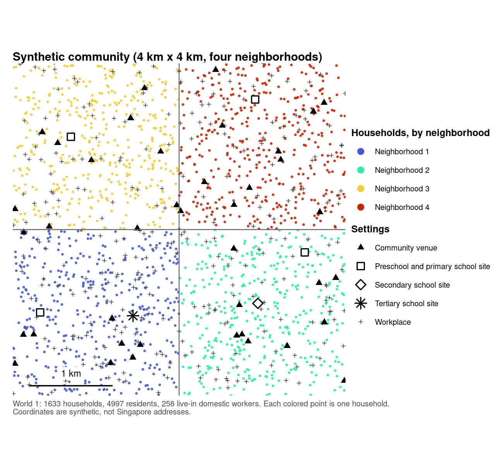

*Figure 1. Layout of the original synthetic community (population 1). Households are colored by neighborhood; school sites, workplaces and community venues are marked. Coordinates are synthetic.*

### 2.2 Contact and movement rules

Time advanced in half-day steps over 155 days (310 steps). Half-day steps separate daytime contacts at school, work and community venues from household contacts at night, as in other influenza individual-based models (Chao et al., 2010), and are short relative to the 2.6-day mean generation interval. Individuals followed a fixed weekly schedule:

- **Night:** everyone was at home.
- **Weekday daytime:** students were at school and employed adults at work. Everyone not staying home also visited their community venue during the same daytime step.
- **Weekends:** there was no school or work, and community venue visits continued.
- **Home in the daytime:** anyone not at school, work or the gathering also had household contacts during the daytime step.
- **Sunday daytime:** each domestic worker attended a gathering of the community's domestic workers with probability 0.75 per week. The statutory rest day of a domestic worker is one day per week, and a Singapore survey reported a mean of 3.26 days off per month (Barua et al., 2020).

Contact required shared presence in a setting, so individuals in different settings could not infect each other, however close their homes. Contact intensities were defined as follows:

- **Home.** The per-pair contact intensity was $h/(n-1)^{0.5}$, with $n$ the household size, which lets per-pair risk fall in larger households, as observed in Hong Kong (Tsang et al., 2019).
- **Schools and workplaces.** Each attendee had the daily number of contacts given by the corrected Prem et al. matrices for Singapore (Prem et al., 2021, 2024), divided by their age band's attendance share. These contacts were spread evenly over the classmates or co-workers present.
- **Community venues.** Contacts followed the Prem et al. "other locations" matrix, made reciprocal for the synthetic population, and were spread over same-venue members of each age band.

For a susceptible individual i, the probability of infection in a step was

$$
P_i = 1 - \exp\Big\{ -\Delta t \, s_i \Big( \sum_k \lambda_{ik} + \lambda_{\mathrm{ext}} \Big) \Big\}
$$

where $\lambda_{ik}$ is the hazard from infectious individuals present in setting $k$, $\lambda_{\mathrm{ext}}$ is the external hazard, $s_i$ is residual susceptibility after vaccination, and $\Delta t$ is 0.5 days.

**Natural history.**

- **Infectiousness** followed a gamma density with mean 2.6 days and standard deviation (SD) 1.1 days. It was zero during the first day and ended with recovery at 8 days, based on challenge studies and household data (Ferguson et al., 2005; Carrat et al., 2008).
- **Symptoms.** Of all infections, 67% became symptomatic, with onset at 1.5 days.
- **Asymptomatic infectiousness.** Never-symptomatic infections were 0.57 times as infectious (Tsang et al., 2023).
- **Staying home.** By assumption, half of symptomatic individuals stayed home from onset until recovery, losing school, work and community contacts but keeping household contacts.

**Random and fixed elements.** Setting assignment, prior immunity, vaccination, symptoms, staying home, rest days, infection and the dose queue were random; the schedule and setting memberships were fixed.

**Calibration.** Two parameters, the transmission scale τ and the household intensity h, were calibrated under existing vaccination only, against infection attack proportions among unvaccinated adults aged 21 to 75 in a Singapore serological cohort (Chen et al., 2013):

- **Reference level:** 13.5%, with an acceptance range of 11.5% to 15.5%.
- **Lower level:** 6.5%, with an acceptance range of 5.0% to 8.0%.

A grid of 55 combinations was run with 5 populations and 10 epidemics each. Every combination whose mean fell inside an acceptance range was retained, and results are reported for each (Table 1). The calibration target was the mean over all runs, including runs in which the epidemic died out.

The grid means were imprecise. Their Monte Carlo standard errors were 1.2 to 1.6 points at the reference level, close to the 2-point half-width of the acceptance range, and five excluded combinations lay within one standard error of a range. The retained sets should therefore be read as a sample of plausible parameter values, not as a precise fit.

Among runs that became major outbreaks, the adult attack proportion was higher: 14.7% to 16.1% at the reference level and 8.2% to 9.5% at the lower level. The lower level therefore differed from the reference level, to a similar degree, both in how often the epidemic died out early and in the size of the epidemics that took off.

Set H1 (τ 0.30, h 1.5) was added post hoc, after the prespecified analyses had been run, as a higher-transmission sensitivity set. Its adult attack proportion, 23.5%, lies above the reference range, so it is not a calibrated set.

The main experiment estimated the same quantity far more precisely (30 populations × 50 epidemics): sets R1 and R4 lay inside the reference range (13.7% and 13.4%), set R2 at its upper edge (15.5%) and set R3 just above it (15.6%). Set R3 is therefore a plausible but marginal set.

The calibration assumed a community closed to outside exposure after the introductions. Adding continued outside exposure to the calibrated sets raised the adult attack proportion under existing vaccination to 19% to 21%, outside the range. The grid was therefore recalibrated post hoc, after the prespecified analyses had been run, with outside exposure of 0.0001 per susceptible person-day over τ 0.10 to 0.28. Four reference-level combinations were retained as sets O1 to O4 and used only with that exposure (Table 1).

The generation interval measured in the simulated transmission chains was 2.85 to 2.91 days in all retained sets, inside the 2.1 to 3.0 day target. Because the incubation period was fixed in the model, the mean serial interval equaled the mean generation interval and was not a separate check. At about 2.8 days, it fell below the 95% confidence interval (2.9 to 4.3 days) around the mean serial interval of 3.6 days observed in Hong Kong households (Cowling et al., 2009), which suggests that the model's generation interval may be too short. This would affect epidemic timing more than final size.

*Table 1. Retained transmission parameter sets and their calibration outcomes under existing vaccination only (Arm A), 5 populations × 10 epidemics per set (sources: `calibration_grid.csv`, `calibration_grid_open.csv` and `calibration_uncertainty.csv`). Sets O1 to O4 were calibrated with continued outside exposure of 0.0001 per susceptible person-day. Adult attack is the attack proportion among unvaccinated residents aged 21 to 75, with its Monte Carlo standard error in parentheses. τ, transmission scale; h, household contact intensity.*

| Set | Level | τ | h | Adult attack, all runs | Adult attack, major outbreaks | Probability of a major outbreak | Older-adult attack | Infections at home | Generation interval |
| --- | --- | --- | --- | --- | --- | --- | --- | --- | --- |
| R1 | Reference | 0.24 | 2.5 | 13.3% (1.2) | 14.7% | 0.86 | 6.0% | 34% | 2.86 days |
| R2 | Reference | 0.26 | 2.0 | 15.2% (1.4) | 16.1% | 0.92 | 6.9% | 30% | 2.87 days |
| R3 | Reference | 0.28 | 1.5 | 13.9% (1.6) | 15.9% | 0.84 | 6.1% | 26% | 2.88 days |
| R4 | Reference | 0.30 | 1.0 | 14.0% (1.3) | 15.7% | 0.86 | 5.8% | 19% | 2.91 days |
| L1 | Lower | 0.20 | 3.0 | 5.2% (0.5) | 8.2% | 0.44 | 2.3% | 38% | 2.85 days |
| L2 | Lower | 0.22 | 2.5 | 6.8% (0.8) | 9.5% | 0.56 | 3.1% | 34% | 2.86 days |
| H1 | Higher (not calibrated) | 0.30 | 1.5 | 23.5% (1.4) | 24.7% | 0.94 | 10.5% | 25% | 2.89 days |
| O1 | Reference, open boundary | 0.22 | 2.5 | 12.8% (0.6) | 12.8% | 1.00 | 6.4% | 34% | 2.86 days |
| O2 | Reference, open boundary | 0.24 | 2.0 | 14.4% (0.4) | 14.4% | 1.00 | 7.2% | 30% | 2.86 days |
| O3 | Reference, open boundary | 0.26 | 1.5 | 15.4% (0.6) | 15.4% | 1.00 | 7.2% | 25% | 2.89 days |
| O4 | Reference, open boundary | 0.28 | 1.0 | 14.3% (0.6) | 14.3% | 1.00 | 6.4% | 19% | 2.89 days |

### 2.3 Simulation procedure

**Synchronous updating.** At every step, disease states were frozen before exposure was computed, and new infections and recoveries were then committed together, so an individual infected in a step could not transmit until a later step. The model stopped with an error if S + I + R differed from the population size at any step. Here I denotes "infected and not yet recovered" and includes the latent period; infectious prevalence was recorded separately.

**Verification.** An automated test suite, run without mocks on a synthetic population built from the stored Census inputs, checked:

- conservation;
- seed reproducibility;
- the absence of same-step transmission;
- zero-transmission cases;
- dose accounting, including the cap on older-adult uptake;
- that the two campaigns produce identical epidemics when vaccine protection is zero;
- that floor area has no effect when its weight is zero;
- for the full-scale geographies, that both parts hold the same people, that every Queenstown household lies at a real address inside its own subzone with the floor area of its dwelling type, that dwelling-type shares match the Census, that pupils attend their nearest primary site, and that infectors share a setting with their cases.

The course harness `abm_check()` was also run on the submitted model (Appendix A).

**Shared random numbers.** For each epidemic, all random numbers were drawn once and shared by the three arms (Stout and Goldie, 2008). In a pilot, this reduced the variance of the paired contrast by 74% to 85% relative to independent random numbers.

**Replicates and seeds.** Each scenario and parameter set was run on 30 populations with 50 epidemics each, giving 1,500 paired epidemics per arm; the 112 combinations of scenario and parameter set comprised 504,000 arm runs in all. Population p used seed p, and epidemic e on population p used seed 2,000,000 + 1,000p + e in every scenario. In the pilot, this design met the Monte Carlo precision target with a wide margin and gave usable precision in small household strata. The simulations ran in R 4.6.1 on a 128-core university server.

### 2.4 Intervention

Each arm sits on top of the same existing vaccination:

- **Arm A:** no additional doses.
- **Arm B:** 10 additional doses per 100 resident adults (410 to 414 doses, depending on the population), given to eligible residents aged 18 and over in a random order.
- **Arm C:** the same number of doses, given first to every eligible resident aged 65 and over and then, if any doses remain, to younger adults in the same random order as Arm B.

On average, Arm C gave 358 doses to older adults and Arm B gave 50. About 757 residents aged 65 and over lived in each population, and about 359 of them had no baseline dose. Arm C therefore vaccinated essentially every older adult without a baseline dose, raising coverage at 65 and over to 100%. It then gave its remaining 54 doses (13%) to younger adults, who were also Arm B recipients because both arms used the same random order. Full uptake among people who had not been vaccinated in the previous year is optimistic, so a scenario with older-adult coverage capped at 75%, an illustrative value without a specific empirical basis, tests this assumption.

**Timing.** Doses were given in equal daily numbers on days 7 to 20 (steps 14 to 41), and each protected from 14 days after it was given.

**Vaccine protection** against infection, for campaign doses, was:

- 40% at ages 18 to 64, rounded from 43% (95% confidence interval 8 to 79) estimated against laboratory-confirmed infection in challenge studies (Basta et al., 2008).
- 30% at 65 and over, derived from the ratio of effectiveness at 65 and over to effectiveness under 65 in a meta-analysis of test-negative studies, 37% versus 51% (Rondy et al., 2017).
- 50% under 18, an assumed value shaded down from 71% against serologically confirmed infection in Hong Kong children (Tsang et al., 2019).

Baseline doses, received at any time in the previous year, were given the same protection multiplied by 0.91 to allow for waning: in a Singapore cohort, relative effectiveness was stable for 26 weeks and fell to 69% at weeks 42 to 49 (Young et al., 2020).

**Scenarios.** Each scenario changed one assumption from the reference. The prespecified scenarios were:

- older-adult protection of 10% or 0%, applied to both baseline and campaign doses;
- continued outside exposure of 0.0001 per susceptible person-day after day 39 (open boundary);
- household exposure weighted by floor area per occupant (γ = 0.5), in the realistic population and after floor area was reassigned at random within strata of household size and structure;
- destinations shuffled to remove their link with distance.

The following scenarios were added post hoc, after the first results had been seen, and were not prespecified:

- continued outside exposure of 0.00002, 0.00005 and 0.0002 per susceptible person-day, to show how the comparison changes with outside exposure;
- the open boundary with outside exposure ending on day 155 and the run continued to day 215, to check whether the 155-day run cut off epidemics still in progress (this run shares every random number of the 155-day run, so the two are paired);
- older-adult protection of 40%, equal to younger adults, and protection of 20% at ages 18 to 64, each applied to baseline and campaign doses, to test vaccine assumptions in the direction that favors prioritization;
- older-adult coverage capped at 75%, with and without the open boundary.

Prespecified sensitivity ranges for four vaccine parameters and a robustness question on staying home were run after the scenarios above, each one at a time in sets R1 to R4 without recalibration:

- protection of children of 30% and 71%;
- baseline coverage at ages 75 and over of 40.6% and 60%;
- baseline coverage of children of 4% and 15%;
- a waning factor for baseline doses of 0.69 and of 1.0 (no waning);
- staying home by 25% and by 75% of symptomatic individuals.

All scenarios were run in the four reference-level sets. The lower-level sets were run in the reference scenario, and the higher-transmission set H1 in the reference and open-boundary scenarios. The open-boundary sets O1 to O4, also added post hoc, were run in the open-boundary scenario with and without the coverage cap.

### 2.5 Outcomes and analysis

**Prespecified hypotheses.** Three hypotheses were stated before the simulations were run. Hypothesis 1 (direct protection): under the reference assumptions, prioritization would produce a lower older-adult attack proportion than broad allocation, and the advantage would shrink as older-adult protection was reduced. Hypothesis 2 (transmission and outside exposure): the advantage of prioritization would be larger at higher transmission and with continued exposure from outside the community. Hypothesis 3 (household effect modification): the advantage of prioritization would be largest for older adults living alone or with a spouse only, and smallest, possibly reversed, for those living with working children, schoolchildren or a domestic worker. The direction of any interaction with floor area per occupant was not predicted. A robustness question asked whether the comparison changes with the probability of staying home, with no direction predicted.

**Primary outcome:** the infection attack proportion among residents aged 65 and over (older adults) between days 35 and 155.

**Primary estimand:** its mean difference between Arm C (prioritization) and Arm B (broad allocation), as Arm C minus Arm B, with negative values favoring prioritization. Differences in attack proportion are reported in percentage points (points).

**Secondary outcomes:**

- epidemic size (the attack proportion among all residents);
- the number of residents infected;
- peak infectious prevalence and the day it occurred;
- infections averted per 100 doses;
- infections by setting;
- spread between neighborhoods;
- the primary contrast within household strata defined at baseline.

**Analysis.**

- **Averaging and Monte Carlo error.** Contrasts were averaged over epidemics within each population, then over populations. The Monte Carlo standard error was the standard deviation of the 30 population means divided by $\sqrt{30}$ (Morris et al., 2019). Intervals are 95% Monte Carlo intervals based on the t distribution with 29 degrees of freedom. They describe simulation error only, conditional on the model structure and the parameter set; they exclude uncertainty in the parameters and in the model's structure and are therefore not confidence intervals for the effect in Singapore. That uncertainty is shown by the spread of results across parameter sets and scenarios.
- **Importance and testing.** A difference of 2 percentage points was prespecified as the smallest important difference, and no hypothesis tests are reported. The margin was set before calibration fixed the scale of the outcome and, at the reference level, proved larger than the total effect of either campaign on older adults (Section 3.3). The comparison is therefore also reported on a relative scale, as the older-adult infections averted by Arm C divided by those averted by Arm B. This ratio was defined post hoc, after the results had been seen, and its standard error was estimated by the jackknife over populations.
- **Extinctions and outbreak threshold.** Early extinctions were retained in all summaries. A major outbreak was defined as a resident attack proportion of at least 5%. Results restricted to major outbreaks are descriptive, because whether an outbreak becomes major depends on the arm.
- **Peak timing** was summarized over all epidemics and over epidemics that became major outbreaks in all three arms. The second summary compares the same epidemics across arms, because the peak of an epidemic that dies out early falls soon after the introductions.
- **Effective reproduction number.** For each parameter set, the effective reproduction number (R) in Arm A was estimated from the exponential growth rate of the number infected (including the latent period) in major outbreaks, from a start day to the day that number reached half its peak. It was converted with a gamma generation interval whose mean was measured in the same runs and whose SD was the input value of 1.1 days (Wallinga and Lipsitch, 2007). Start days 40 and 45 were compared, because the individuals infected from outside on days 35 to 39 recover by day 47.
- **Household strata** were descriptive. There were 15 distinct stratum levels in each combination of scenario and parameter set, and no adjustment was made for the number of comparisons.

### 2.6 Full-scale extension: a synthetic square and the Queenstown planning area

The original community is small (about 5,000 residents) and its geography stylized: a 4 km square with four equal neighborhoods and homes, schools, workplaces and venues at random coordinates. Spatial individual-based models of respiratory infection in Singapore have placed households in real Master Plan subzones and assigned schools and workplaces from travel data (Koo et al., 2020; Dickens et al., 2020), and landmark influenza models used census geography or gridded population density (Ferguson et al., 2005; Chao et al., 2010). After the main experiment, the study was therefore extended to two full-scale geographies that shared their populations and differed only in where people lived and where they went, and in how floor area was assigned, which defined household strata but did not affect transmission (Table 2).

**Population.** For each of 16 population seeds, one population was synthesized to the resident population of the Queenstown planning area in Census 2020: 95,930 residents with Queenstown's age and sex distribution, and 37,052 households with Queenstown's household-size distribution (the sum of the Census 2020 household-size cells; the published total is 37,053; Singapore Department of Statistics, Census 2020). Within each household size, household structure followed the national distribution, and older adults' living arrangements followed the national distribution by age, scaled to Queenstown's share of residents aged 65 and over. The share of households with a domestic worker was set to the national 15.8%. Each population held about 102,000 individuals including domestic workers.

**Part 1: synthetic square.** The population was placed in a square of Queenstown's land area (21.7 km², 4.66 km side) divided into 13 neighborhoods, one per populated Queenstown subzone. The neighborhoods were the Voronoi cells of 13 random centers, so that they differed in size as subzones do. Homes, school sites, venue sites and workplaces were placed uniformly at random, with the same numbers of preschool, school, tertiary and venue sites as in Part 2. Floor area was drawn as in the original community.

**Part 2: Queenstown.** The same population was placed on the real geography of the Queenstown planning area, in SVY21, Singapore's national projected coordinate system (Figure 2):

- **Subzone and dwelling type.** Each household was assigned to one of the 13 populated subzones (Urban Redevelopment Authority Master Plan 2019) and to a dwelling type by simulated annealing, to match three Census 2020 tables at once: residents by subzone and 5-year age band, residents by subzone and dwelling type, and households by dwelling type. The fit is reported in Section 3.6.
- **Address.** A household in public housing was placed at one of Queenstown's 242 Housing and Development Board (HDB) residential blocks in its subzone, chosen in proportion to the block's number of flats of the household's type (34,920 flats in all; HDB Property Information, geocoded with the OneMap search service), with a random offset of up to 15 m in each coordinate. A household in a condominium, other apartment or landed property was placed at a random point on a private residential parcel of its kind in its subzone: a Master Plan 2019 residential parcel with no HDB block within 20 m, sampled in proportion to its area times its permitted gross plot ratio. Where a subzone had no parcel of the household's kind, any private parcel in the subzone was used, and failing that a parcel of its kind elsewhere in Queenstown.
- **Floor area** followed the dwelling type at the address, uniformly within ranges for each type (HDB 1 and 2 room 30 to 47 m², 3 room 60 to 75 m², 4 room 85 to 105 m², 5 room and executive 105 to 150 m²; assumed ranges of 60 to 150 m² for condominiums and 150 to 400 m² for landed homes). Floor area per occupant therefore varied with housing type and location, not only with household size. Floor area did not affect transmission at full scale (the living-space weight was zero) and was used only to define household strata.
- **Schools.** The school sites were the 9 primary and 12 secondary schools within 1 km of Queenstown and, for tertiary education, Anglo-Chinese Junior College and the National University of Singapore (Kent Ridge) and Singapore Polytechnic campuses. The 129 preschool records within 500 m (Ministry of Education and Early Childhood Development Agency data) stood at 99 distinct locations, because some centers were listed twice; because pupils attended the nearest site, 99 preschool sites were used in Part 2, whereas Part 1 placed 129.
- **Workplaces** were placed at points on parcels zoned for business, commerce (including mixed residential-commercial and white sites), institutions, places of worship, health care, education, sports and recreation, utilities, transport, special use and the port, in proportion to parcel area times plot ratio.
- **Community venues** were the 10 existing hawker centers and 5 community clubs within 300 m of Queenstown (National Environment Agency; People's Association), one of which (Ulu Pandan) was listed as under construction, and the 14 licensed supermarket sites inside Queenstown (National Environment Agency supermarket licenses, geocoded with OneMap).

The facility and housing data date from 2021 to 2026 rather than 2020: 14 of the 242 HDB blocks, with 2,409 flats, were completed after the Census. The model therefore combines the 2009 transmission calibration, the 2020 population and the current built environment.

**Shared rules.** In both parts, preschool and primary pupils attended their nearest site of that level, because primary school admission in Singapore gives priority by home distance. Secondary and tertiary students, workers and venue users chose a site with weights $\exp(-d/1\,\mathrm{km})$, with $d$ the distance. Group sizes were those of the original community: classes of up to 15, 30 or 50, workplaces of 10 workers on average, groups of about 125 regular users at each venue (so a hawker center hosted several groups) and domestic-worker gatherings of about 250. Contact rates, natural history, vaccination and the dose queue were unchanged. Workplaces, schools and venues were all inside or next to the modeled area; contact with people living elsewhere was represented only by the external hazard. This matters most for Queenstown, which is a place of work as much as of residence: in Census 2020, 131,782 employed residents of Singapore worked in Queenstown, while 48,300 employed residents lived there (Singapore Department of Statistics, Census 2020). Most of the people a Queenstown worker meets at work therefore live elsewhere, and many Queenstown residents work elsewhere, so the open-boundary scenario is the more plausible description of this area.

**Design.** The parameter sets were not recalibrated. Sets R1 to R4 were run in the reference scenario, in the open boundary and with shuffled destinations; sets O1 to O4 in the open boundary with and without the 75% coverage cap; and sets R1 to R4 with older-adult protection of 10% and of 40%, applied to baseline and campaign doses. Each of these 28 combinations was run in both parts on the same 16 populations with 10 epidemics each, using epidemic seeds 3,000,000 + 1,000p + e in every combination and both parts, which gave 8,960 paired epidemics and 26,880 arm runs. Each population was weighted equally, and Monte Carlo intervals used the t distribution with 15 degrees of freedom. The adult attack proportion under existing vaccination is reported as a check on the calibration. The effect of geography on the primary contrast was estimated as the difference between Part 2 and Part 1, paired by population and epidemic seed. The extension was added after the main results had been seen. A first run of the extension, stopped at a compute deadline, used inputs that omitted the National University of Singapore campus and the supermarkets and recorded older-adult infections by subzone incorrectly; it was superseded by this corrected rerun and is not reported.

*Table 2. Characteristics of the three model geographies: the original synthetic community and the two full-scale geographies of the Queenstown planning area, a synthetic square of the same area and its real geography. HDB, Housing and Development Board.*

| | Original community | Part 1: synthetic square | Part 2: Queenstown |
| --- | --- | --- | --- |
| Residents | about 5,000 | 95,930 | 95,930 |
| Population targets | National | Queenstown | Queenstown |
| Area | 16 km² square | 21.7 km² square | 21.7 km² planning area |
| Neighborhoods | 4 equal quadrants | 13 Voronoi cells | 13 populated subzones |
| Homes | Random points | Random points | HDB blocks and private parcels by subzone |
| Floor area | By household size | By household size | By dwelling type at the address |
| Schools and venues | 4 combined preschool and primary, 2 secondary, 1 tertiary, 40 venues, random | Same counts as the Part 2 records (129 preschools), random | Real sites (99 distinct preschool locations) |
| Workplaces | Random points | Random points | Points on business, commercial and institutional land |
| Populations × epidemics per combination | 30 × 50 | 16 × 10 | 16 × 10, same populations and seeds as Part 1 |

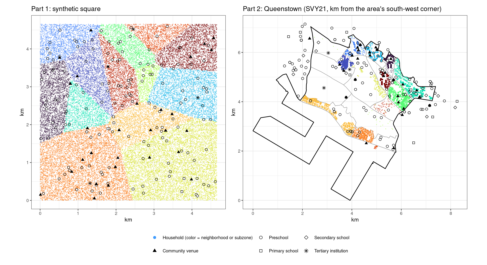

*Figure 2. Synthetic population 1 in the two full-scale geographies. Points are households, colored by neighborhood (Part 1, synthetic square) or subzone (Part 2, Queenstown planning area); symbols mark preschools, schools, tertiary campuses and community venues. Part 2 shows the Queenstown planning-area boundary (black) and its subzones (gray) in SVY21 projected coordinates; the large empty areas are subzones with few or no residents (Port, Kent Ridge, National University of Singapore, Singapore Polytechnic, One North and Queensway). Workplaces are not shown.*

## 3. Results

### 3.1 Verification

`abm_check()` passed all 14 of its checks on the submitted model (Appendix A). These covered conservation of S + I + R at every step under all three arms and the open boundary; monotone S and R; seed reproducibility; zero transmission when transmission and introductions were switched off (the 1,017 individuals in R at the start of that check were those immune at the start); and individuals remaining inside the bounded area. Because individuals in this model never change their coordinates, the two boundary checks pass by construction and test nothing about contact.

The contact logic was instead tested by the model's own test suite, which also passed (log: `results/summary/test_log.txt`). This suite checks that no individual transmits in the step in which they were infected, that every infection is external when there is no local transmission, and that floor area has no effect when its weight is zero. The two campaigns produced identical epidemics when vaccine protection was zero, confirming that the arms were paired and differed only in vaccination. After the code was extended for the full-scale geographies, three epidemics rerun on the original community reproduced the stored main-experiment results exactly (`results/summary/reproduction_check.txt`).

### 3.2 Epidemic dynamics

Figure 3 shows daily S, I, R and infectious counts for 300 epidemics per arm in set R3. Infection entered on day 35. In Arm A, the mean day of peak infectious prevalence was 72.2 to 75.8 across the reference sets, or 74.3 to 77.4 among epidemics that became major outbreaks in all three arms. Most epidemics had ended by day 155; on average, 4.8 to 6.1 individuals were still infected then under Arm A and 3.4 to 5.5 under Arms B and C.

The estimated effective reproduction number (R) in Arm A depended on when the growth fit started (`growth_rate_R.csv`). From day 40, it was 1.18 to 1.20 at the reference level (95% Monte Carlo intervals within 1.15 to 1.22), 1.06 and 1.09 at the lower level and 1.25 in set H1. From day 45, it was 1.05 to 1.07 at the reference level, 1.02 at the lower level and 1.13 in set H1. The earlier window includes the first generation of local infections, all of which follow the introductions of days 35 to 39, so the later estimate is probably closer to the sustained growth rate.

The reference epidemics were only modestly supercritical. With about 19 introductions per epidemic, 8% to 13% of Arm A epidemics at the reference level did not become major outbreaks, a fraction consistent with R of about 1.06 and independent transmission chains but one that would require strongly overdispersed transmission at R of 1.2. Either value lies below the median of 1.28 (interquartile range 1.19 to 1.37) for published seasonal influenza estimates (Biggerstaff et al., 2014).

In Arm A of the reference sets, 19% to 34% of locally acquired infections occurred at home, 9% to 11% at school, 15% to 18% at work, 42% to 52% in community venues and 0.3% at the domestic workers' gathering. Of domestic workers, 10.9% to 13.2% were infected. Almost every epidemic reached all four neighborhoods (mean 4.00 in set R3).

Because transmission depended on shared settings rather than on distance between homes, infections were only modestly clustered in space: in set R3, about 43% of local transmission events crossed neighborhoods, against about 75% expected if contacts ignored neighborhood. Figure 4 shows one epidemic of median size at common times, with campaign recipients marked.

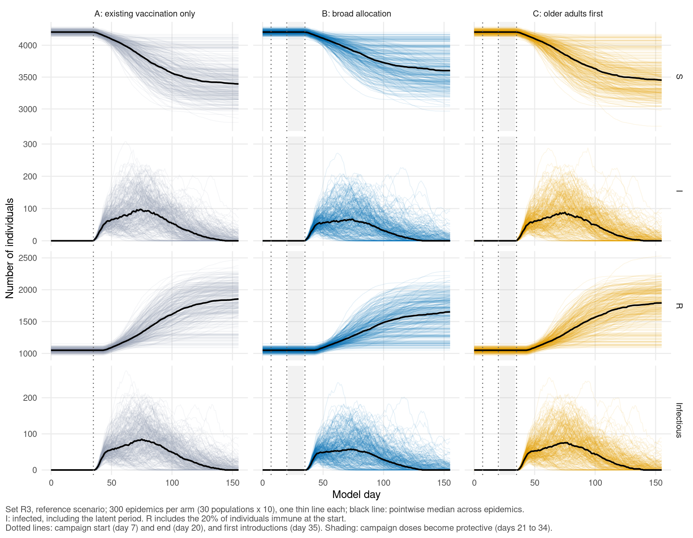

*Figure 3. Daily numbers of susceptible (S), infected including latent (I), recovered or immune (R) and infectious individuals under Arms A (no additional doses), B (broad allocation) and C (prioritization of older adults), parameter set R3, reference scenario. Thin lines are individual epidemics; black lines are pointwise medians across epidemics. R includes the 20% of individuals immune at the start. Shading marks the days on which campaign doses become protective.*

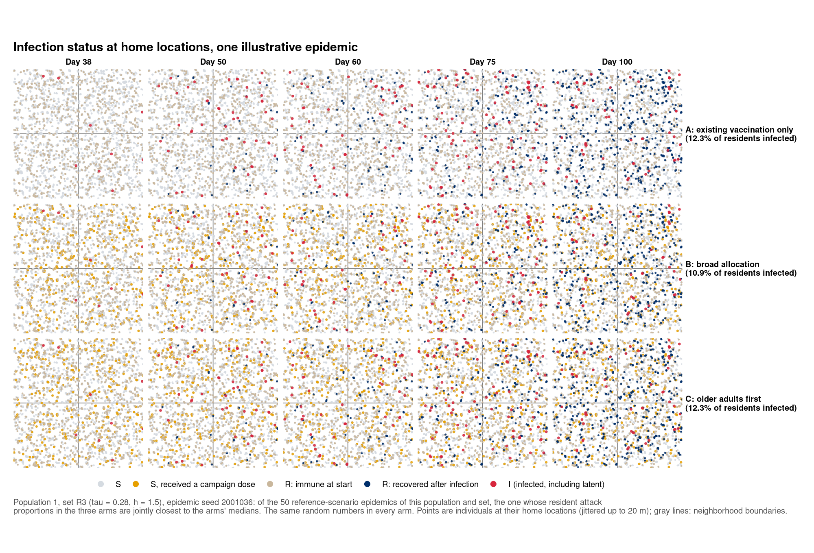

*Figure 4. Infection status at home locations at common time points in one reference-scenario epidemic (population 1, parameter set R3, epidemic seed 2,001,036) under Arms A (no additional doses), B (broad allocation) and C (prioritization of older adults), which used the same random numbers. The epidemic was chosen among the 50 reference epidemics on that population as the one whose resident attack proportions in the three arms were jointly closest to the arms' medians; it infected 12.3%, 10.9% and 12.3% of residents under Arms A, B and C. Orange points are susceptible individuals who received a campaign dose; gray lines are neighborhood boundaries.*

### 3.3 Effect of the interventions

Table 3 and Figure 5 compare the arms under the reference assumptions.

**Epidemic size and number infected.** Both campaigns reduced the size of the epidemic, and broad allocation reduced it more. In set R3, the resident attack proportion fell from 14.5% under Arm A to 10.9% under Arm B and 13.2% under Arm C, or about 724, 543 and 660 of roughly 5,000 residents infected. Per 100 doses, broad allocation averted 37 to 44 resident infections in the reference sets, against 15 to 17 for prioritization.

**Peak.** Both campaigns lowered peak infectious prevalence, but their effect on peak timing was small, and its direction depended on the scenario. Averaged over all epidemics in set R3, the peak came 5.1 days earlier under Arm B and 1.3 days earlier under Arm C, partly because more epidemics died out early under the campaigns. Among epidemics that became major outbreaks in all three arms, the peak came 1.9 to 3.0 days earlier under Arm B than under Arm A in sets R1 to R4, whereas the shift under Arm C was smaller and its intervals included zero in every set (`peak_shift.csv`). Near the epidemic threshold, the prevalence curve under Arm B was flat for several weeks (Figure 3), so its maximum could fall early. With continued outside exposure at 0.0002 per day, Arm B instead delayed the peak by 1.2 to 2.1 days.

*Table 3. Attack proportions and epidemic peak by arm and parameter set, reference scenario. Values are means over 30 populations × 50 epidemics, with Monte Carlo standard errors in parentheses (source: `arm_means.csv`). Peak values are over all epidemics. Residents infected ≈ resident attack proportion × 5,000. Arm A, no additional doses; Arm B, broad allocation; Arm C, prioritization of older adults.*

| Set | Arm | Older-adult attack, % | Resident attack, % | Peak infectious | Peak day |
| --- | --- | --- | --- | --- | --- |
| R1 | A | 6.52 (0.07) | 12.84 (0.13) | 104.5 (0.9) | 72.6 (0.6) |
| R1 | B | 4.90 (0.06) | 9.64 (0.09) | 83.6 (0.7) | 66.9 (0.6) |
| R1 | C | 4.98 (0.07) | 11.57 (0.13) | 96.0 (0.7) | 71.1 (0.7) |
| R3 | A | 6.93 (0.07) | 14.48 (0.13) | 117.8 (1.1) | 75.8 (0.6) |
| R3 | B | 5.16 (0.06) | 10.85 (0.12) | 93.4 (1.0) | 70.7 (0.5) |
| R3 | C | 5.33 (0.06) | 13.20 (0.13) | 108.6 (1.1) | 74.6 (0.5) |
| L2 | A | 3.32 (0.04) | 6.53 (0.08) | 66.0 (0.5) | 59.5 (0.4) |
| L2 | B | 2.56 (0.04) | 4.95 (0.06) | 56.9 (0.4) | 55.8 (0.3) |
| L2 | C | 2.55 (0.04) | 5.90 (0.07) | 62.3 (0.4) | 58.5 (0.4) |
| H1 | A | 10.86 (0.07) | 22.08 (0.12) | 185.2 (1.3) | 79.9 (0.4) |
| H1 | B | 8.68 (0.08) | 17.88 (0.14) | 146.0 (1.1) | 79.5 (0.4) |
| H1 | C | 8.59 (0.07) | 20.60 (0.14) | 170.8 (1.2) | 80.1 (0.5) |

Sets R2, R4 and L1 followed the same pattern (`arm_means.csv`).

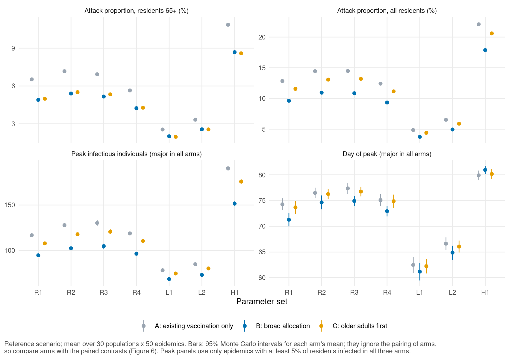

*Figure 5. Attack proportions and epidemic peak size and timing under Arms A (no additional doses), B (broad allocation) and C (prioritization of older adults), by parameter set, reference scenario. Attack proportions are over all epidemics; peak size and timing are over epidemics with at least 5% of residents infected in all three arms. Bars are 95% Monte Carlo intervals for each arm's mean and ignore the pairing of arms; Figure 6 gives the paired comparison.*

**Older adults.** Both campaigns reduced the older-adult attack proportion by similar amounts: by 1.4 to 1.8 percentage points at the reference level, 0.5 to 0.8 points at the lower level and 2.2 to 2.3 points in set H1. Per 100 doses, broad allocation averted 2.6 to 3.2 older-adult infections in the reference sets and prioritization 2.5 to 3.0. The primary contrast, Arm C minus Arm B, was +0.04 to +0.17 points across the four reference sets (Monte Carlo standard errors 0.03 to 0.05), favoring broad allocation in every set, with intervals excluding zero in sets R2 and R3. It was −0.04 points in set L1 (95% Monte Carlo interval −0.07 to −0.01), 0.00 in set L2 and −0.09 points in set H1 (interval −0.19 to +0.01). All of these lie well inside the prespecified 2-point margin, but that margin exceeds the whole effect of either campaign on older adults, so it could not have been crossed under the reference assumptions. On the relative scale, prioritization averted 90% to 97% as many older-adult infections as broad allocation at the reference level (ratio 0.90 to 0.97; Table 4).

**Where the difference came from.** Broad allocation's small advantage in the reference scenario was concentrated, arithmetically, in the pairs in which only prioritization produced a major outbreak. The per-epidemic contrast varied far more between epidemics than its mean (Figure 7): its median was zero or −0.13 points (one older adult), and Arm C produced fewer older-adult infections in about half of the paired epidemics. In the reference sets, the probability of a major outbreak was 0.87 to 0.92 under Arm A, 0.76 to 0.83 under Arm B and 0.83 to 0.90 under Arm C. In 7% to 10% of pairs, a major outbreak occurred under prioritization but not under broad allocation; the reverse occurred in about 1%. In pairs in which both arms had a major outbreak, the contrast was −0.10 to +0.02 points. Because these subgroups are defined by an outcome that depends on the arm, they describe where the mean difference arose rather than estimate a separate effect.

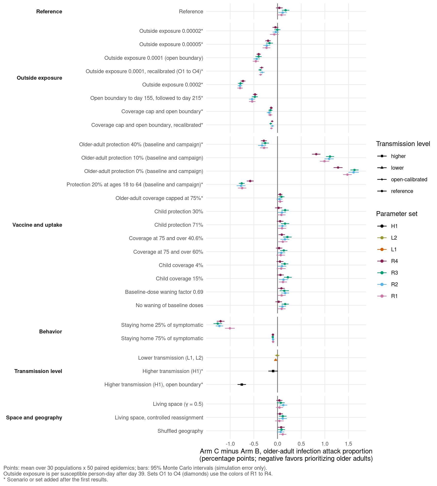

*Figure 6. Primary contrast, the older-adult attack proportion under Arm C (prioritization) minus that under Arm B (broad allocation), in percentage points, in every scenario and parameter set. Points are means over 30 populations × 50 paired epidemics; bars are 95% Monte Carlo intervals, which reflect simulation error only. Negative values favor prioritizing older adults.*

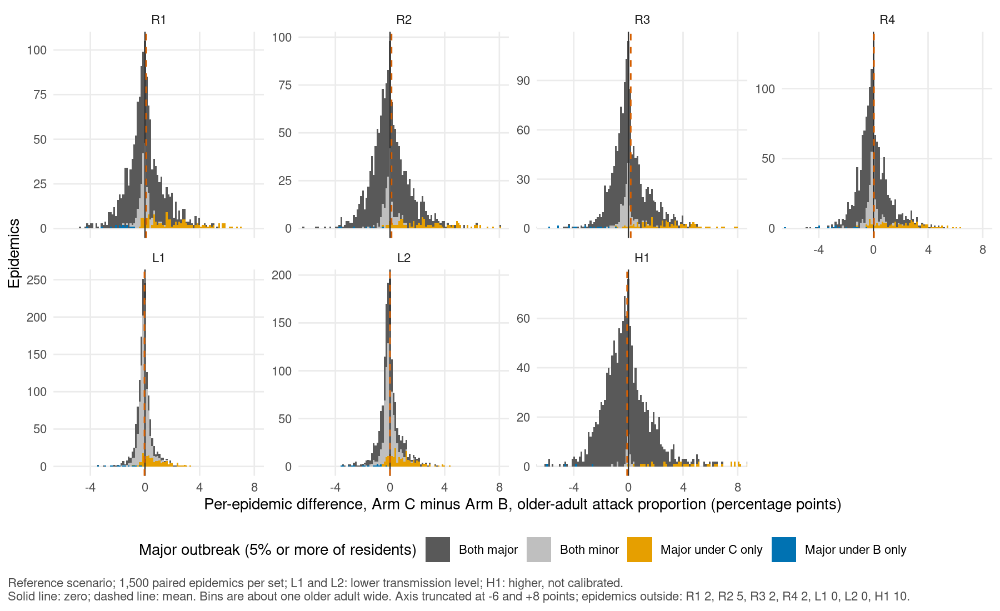

*Figure 7. Distribution of the per-epidemic primary contrast, the older-adult attack proportion under Arm C (prioritization) minus that under Arm B (broad allocation), in percentage points, reference scenario, 1,500 paired epidemics per parameter set. Bars are colored by whether a major outbreak occurred under both arms, neither, or only one. Dashed lines mark the mean.*

### 3.4 Robustness of the comparison

Table 4 and Figures 6 and 8 show how the comparison changed with each assumption.

*Table 4. Older-adult attack proportion, Arm C minus Arm B (percentage points), and the ratio of older-adult infections averted by Arm C to those averted by Arm B, sets R1 to R4 unless stated (sources: `contrasts.csv`, `averted_ratio.csv`). Negative differences and ratios above 1 favor prioritization. Outside exposure is per susceptible person-day after day 39. Rows marked * were added post hoc.*

| Scenario | C minus B | Ratio C : B |
| --- | --- | --- |
| Reference | +0.04 to +0.17 | 0.90 to 0.97 |
| Outside exposure 0.00002* | −0.07 to 0.00 | 1.00 to 1.04 |
| Outside exposure 0.00005* | −0.23 to −0.17 | 1.10 to 1.15 |
| Outside exposure 0.0001 (open boundary) | −0.46 to −0.40 | 1.25 to 1.29 |
| Outside exposure 0.0001, recalibrated sets O1 to O4* | −0.37 to −0.33 | 1.28 to 1.35 |
| Outside exposure 0.0002* | −0.79 to −0.73 | 1.51 to 1.53 |
| Open boundary to day 155, followed to day 215* | −0.54 to −0.47 | 1.31 to 1.35 |
| Older-adult protection 40%, baseline and campaign* | −0.33 to −0.26 | 1.15 to 1.21 |
| Older-adult protection 10%, baseline and campaign | +0.82 to +1.11 | 0.41 to 0.45 |
| Older-adult protection 0%, baseline and campaign | +1.28 to +1.63 | 0.16 to 0.18 |
| Protection 20% at ages 18 to 64, baseline and campaign* | −0.77 to −0.58 | 1.58 to 1.75 |
| Older-adult coverage capped at 75%* | +0.04 to +0.08 | 0.95 to 0.98 |
| Coverage cap and open boundary* | −0.18 to −0.13 | 1.09 to 1.11 |
| Coverage cap and open boundary, recalibrated sets O1 to O4* | −0.14 to −0.11 | 1.10 to 1.13 |
| Living space (γ = 0.5) | +0.04 to +0.12 | 0.93 to 0.97 |
| Living space, controlled reassignment | +0.04 to +0.11 | 0.93 to 0.97 |
| Shuffled geography | +0.07 to +0.11 | 0.93 to 0.96 |
| Child protection 30% | +0.02 to +0.16 | 0.91 to 0.98 |
| Child protection 71% | +0.06 to +0.16 | 0.91 to 0.96 |
| Coverage at 75 and over 40.6% | +0.09 to +0.21 | 0.88 to 0.94 |
| Coverage at 75 and over 60% | +0.03 to +0.13 | 0.92 to 0.98 |
| Child coverage 4% | +0.05 to +0.15 | 0.91 to 0.96 |
| Child coverage 15% | +0.06 to +0.22 | 0.87 to 0.96 |
| Baseline-dose waning factor 0.69 | +0.08 to +0.16 | 0.92 to 0.95 |
| No waning of baseline doses | +0.03 to +0.16 | 0.90 to 0.98 |
| Staying home 25% of symptomatic | −1.26 to −1.01 | 1.47 to 1.63 |
| Staying home 75% of symptomatic | −0.10 to −0.09 | 1.42 to 1.68 |

**Outside exposure.** The ranking reversed as exposure from outside the community increased (Figure 8). With continued exposure of 0.00002 per day, which added about 8 infections per epidemic from outside the community, the difference between the campaigns was close to zero (−0.07 to 0.00 points; intervals −0.16 to +0.06). The older-adult attack proportion was 0.40 to 0.46 points lower under prioritization at 0.0001 per day and 0.73 to 0.79 points lower at 0.0002 per day. As outside exposure rose, nearly every epidemic became a major outbreak in every arm, and broad allocation no longer reduced the number of major outbreaks. About 60% to 66% of the open-boundary difference arose from infections acquired inside the community and the rest from outside exposure itself (`contrasts.csv`).

Because sets R1 to R4 were calibrated without continued outside exposure, adding it enlarged the epidemics. The adult attack proportion under existing vaccination rose from 13.4% to 15.6% in the reference scenario to 15.0% to 17.0%, 16.9% to 18.7%, 19.3% to 21.0% and 22.9% to 24.4% at the four exposure levels. In the sets recalibrated with outside exposure of 0.0001 per day (O1 to O4), it was 13.0% to 15.0%, inside the acceptance range. Prioritization remained ahead in these sets, by 0.33 to 0.37 points, and averted 1.28 to 1.35 times as many older-adult infections as broad allocation.

**Final size under the open boundary.** The 155-day outcome slightly understated prioritization's advantage under continued exposure. When outside exposure stopped on day 155 and the same epidemics were followed to day 215, fewer than one individual per epidemic was still infected at the end, and the difference widened from 0.40 to 0.46 points to 0.47 to 0.54 points.

**Vaccine protection.** The comparison depended strongly on the assumed protection of each group. All four vaccine scenarios changed protection from baseline doses as well as campaign doses, which also changed the size of the epidemic under existing vaccination. With older-adult protection of 10% or 0%, broad allocation was better by 0.82 to 1.11 and 1.28 to 1.63 points, respectively. These scenarios raised older adults' risk in every arm; with no older-adult protection, Arm C reduced older-adult infection by only 0.27 to 0.33 points relative to Arm A, through the 54 doses it gave to younger adults. Conversely, prioritization was better by 0.26 to 0.33 points with older-adult protection equal to that of younger adults (40%) and by 0.58 to 0.77 points with protection of 20% at ages 18 to 64. The latter scenario also enlarged the epidemic: the adult attack proportion under existing vaccination was 17.2% to 19.6%, against 13.4% to 15.6% in the reference scenario.

**Coverage cap.** When older-adult coverage was capped at 75%, Arm C gave 169 doses to older adults instead of 358 and the rest to younger adults, so the two arms differed in about 119 of 412 doses instead of about 308. The contrast was then +0.04 to +0.08 points under the reference assumptions. With the open boundary, it was −0.13 to −0.18 points in sets R1 to R4 and −0.11 to −0.14 in sets O1 to O4, about a third of the uncapped value; the difference per dose moved from younger to older adults was about the same with and without the cap.

**Transmission level.** At both the lower level and in set H1, the contrast was slightly more favorable to prioritization than at the reference level (Section 3.3). This comparison is weak, because the H1 interval included zero and H1's R was only 0.05 to 0.08 above that of the reference sets. In set H1 with the open boundary, prioritization was better by 0.76 points.

**Vaccine-parameter ranges.** Across the prespecified ranges for protection of children, baseline coverage at ages 75 and over, baseline coverage of children and waning of baseline doses, the contrast stayed between +0.02 and +0.22 points and the ratio of older-adult infections averted between 0.87 and 0.98, close to the reference values (+0.04 to +0.17 points; 0.90 to 0.97). The point estimate favored broad allocation in every set of all eight scenarios, as in the reference scenario.

**Staying home.** The probability of staying home after symptom onset changed the size of the epidemic far more than any other single assumption, because transmission was calibrated with a probability of 0.5 and was not recalibrated. With 25% staying home, the adult attack proportion under existing vaccination rose to 34.7% to 38.1%, almost every epidemic became a major outbreak, and prioritization was ahead by 1.01 to 1.26 points (ratio 1.47 to 1.63). With 75% staying home, adult attack fell to 2.2% to 2.9%, fewer than 10% of epidemics became major outbreaks, and prioritization was ahead by 0.09 to 0.10 points. These scenarios therefore mainly vary transmission intensity; they do not isolate the effect of staying home on the comparison.

**Living space and spatial structure.** Weighting household exposure by floor area per occupant left the contrast at +0.04 to +0.12 points, and reassigning floor area within strata gave the same result. Shuffling destinations increased transmission between neighborhoods (in set R3, from 320 to 412 such transmission events per epidemic under Arm A) but changed attack proportions by 0.3 points or less, and the contrast was +0.07 to +0.11 points.

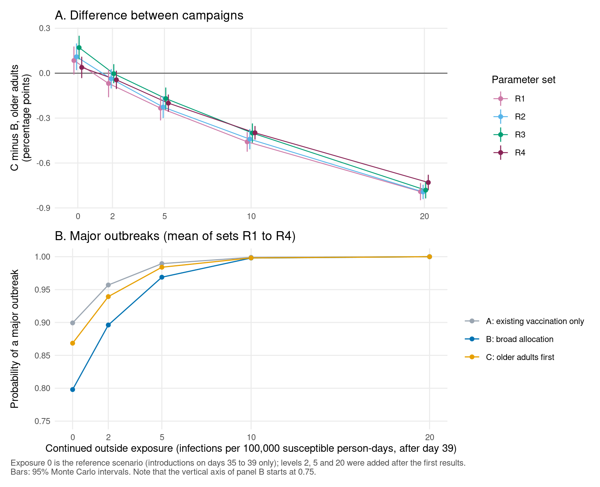

*Figure 8. Effect of continued exposure from outside the community on the comparison of allocations. (A) Primary contrast, the older-adult attack proportion under Arm C (prioritization) minus that under Arm B (broad allocation), with 95% Monte Carlo intervals. (B) Probability of a major outbreak in each arm, averaged over parameter sets R1 to R4. Exposure 0 is the reference scenario; levels 2, 5 and 20 per 100,000 susceptible person-days were added post hoc. These sets were calibrated without continued exposure.*

### 3.5 Household effect modification

Under the reference assumptions, the contrast varied little between household strata, and the pattern was not consistent across sets (Figure 9). In set R3, it was +0.23 points (Monte Carlo standard error 0.05) for older adults living with their own children and +0.25 in households of 5 or more occupants, against +0.02 for those living alone; in set R1, the gradient by household size was not monotone. These estimates are descriptive, as 15 distinct stratum levels were examined in each scenario and set, without adjustment for multiple comparisons.

**When older adults gained little or no protection, or adults under 65 less.** Household composition mattered more when the vaccine protected older adults poorly or younger adults less well. In set R3, the contrast for older adults living alone against those living with someone under 18 was +0.99 against +2.17 points with no older-adult protection (+2.15 in households of 5 or more occupants), +0.63 against +1.49 with older-adult protection of 10%, and −0.55 against −1.02 with protection of 20% at ages 18 to 64. Under these assumptions, the difference between allocations was about twice as large (1.8 to 2.3 times) for older adults living with someone under 18 as for those living alone. With no older-adult protection, point estimates of 2 points or more occurred for older adults living with someone under 18 (2.16 to 2.22, sets R1 to R3), in households of 5 or more (2.15 to 2.27, sets R1 to R3) and in the lowest third of floor area per occupant (2.01, set R2). Their lower 95% Monte Carlo bounds were 1.88 to 2.10, so several do not clearly exceed 2.

**Domestic workers.** Older adults in households with a domestic worker had a higher attack proportion under Arm A than those without (7.8% against 6.7% in set R3), but the contrast between arms was the same in both groups, +0.17 points. This result depends on assumed contact patterns, because no Singapore contact data for domestic workers were available, and domestic workers were not eligible for additional doses in either arm.

**Floor area.** Older adults in the lowest third of floor area per occupant had a higher attack proportion than those in the highest third, 8.4% against 5.3% under Arm A in set R3. This difference reflects household size: older adults in the lowest third lived in households of 4.8 occupants on average, against 2.0 in the highest third (`occupants_by_area.csv`), and floor area had no effect on transmission in the reference scenario.

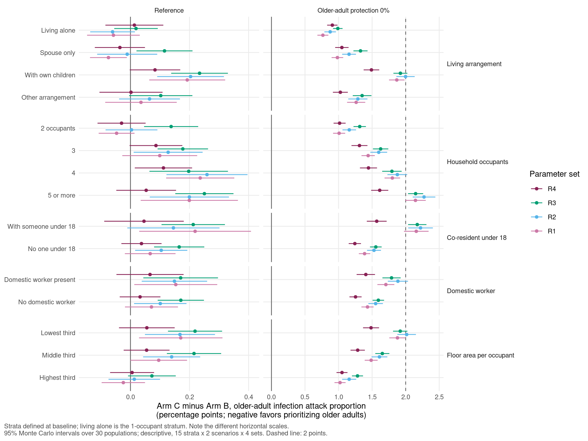

*Figure 9. Primary contrast, the older-adult attack proportion under Arm C (prioritization) minus that under Arm B (broad allocation), within household strata defined at baseline, in the reference scenario and with older-adult protection of 0%, parameter sets R1 to R4, with 95% Monte Carlo intervals. The two panels have different horizontal scales; the dashed line marks 2 percentage points.*

### 3.6 Full-scale extension: synthetic square and Queenstown

**Populations and calibration check.** All 16 populations were accepted at the first attempt. Each held 37,052 households, 95,957 to 95,973 residents and 5,852 to 5,860 domestic workers. The worst standardized absolute errors were 0.030 for age and sex, 0.037 for household structure by size and 0.096 for older adults' living arrangements, close to the 0.10 limit, probably because the national living arrangements had to fit Queenstown's smaller households. In Part 2, the fits to residents by subzone and age, residents by subzone and dwelling type, and households by dwelling type had errors of at most 0.047, 0.011 and 0.002. Under existing vaccination, the adult attack proportion in the reference scenario was 10.9% to 13.4% in Part 1 and 11.1% to 13.6% in Part 2, inside the reference range (11.5% to 15.5%) or up to 0.6 points below it, without recalibration. With continued outside exposure, it was 16.0% to 18.2% in sets R1 to R4, above the range, and 10.6% to 12.9% in sets O1 to O4, up to 0.9 points below it.

**Almost no early extinction.** The early extinctions that drove the result in the original community played almost no part at full scale. The five days of introductions produced about 371 imported infections rather than about 19, and all but 8 of the 8,960 paired epidemics became major outbreaks in every arm; in each of the 8, the epidemic stayed below 5% of residents under Arm B only.

**Primary contrast** (Table 5, Figure 10). Under the reference assumptions, broad allocation protected older adults better in both parts: Arm C minus Arm B was +0.26 to +0.34 percentage points in Part 1 and +0.29 to +0.34 in Part 2, and prioritization averted 73% to 79% as many older-adult infections as broad allocation. Both campaigns lowered the older-adult attack proportion, by 1.2 to 1.4 points under Arm B and by 0.9 to 1.1 points under Arm C. With continued outside exposure, the ranking reversed: prioritization was ahead by 0.08 to 0.10 points in sets R1 to R4 and by 0.09 to 0.14 points in sets O1 to O4, and it averted 1.06 to 1.19 times as many older-adult infections as broad allocation. With older-adult coverage capped at 75% and outside exposure, prioritization was ahead by 0.03 to 0.07 points. These differences are smaller than in the original community, where prioritization was ahead by 0.33 to 0.46 points under outside exposure.

**Vaccine protection at full scale.** With older-adult protection of 10%, broad allocation was ahead by 0.94 to 1.08 points in Part 1 and 0.97 to 1.04 in Part 2, close to the 0.82 to 1.11 points of the original community. With older-adult protection of 40%, equal to that of younger adults, the two allocations were indistinguishable at full scale (0.00 to +0.02 points in Part 1 and −0.02 to +0.03 in Part 2, every interval including zero), whereas prioritization was ahead by 0.26 to 0.33 points in the original community.

*Table 5. Primary contrast, the older-adult attack proportion under Arm C (prioritization) minus that under Arm B (broad allocation), in percentage points, in the two full-scale geographies of the Queenstown planning area (a synthetic square of the same area and its real geography) and the paired difference between them; 16 populations × 10 epidemics per combination, with ranges over parameter sets. Negative values favor prioritization. Outside exposure is per susceptible person-day. Sources: `ext_contrasts.csv` and `ext_geography_difference.csv`.*

| Scenario | Sets | Part 1: square | Part 2: Queenstown | Part 2 minus Part 1 |
| --- | --- | --- | --- | --- |
| Reference | R1 to R4 | +0.26 to +0.34 | +0.29 to +0.34 | −0.05 to +0.05 |
| Shuffled destinations | R1 to R4 | +0.31 to +0.34 | +0.30 to +0.32 | −0.03 to −0.01 |
| Outside exposure 0.0001 | R1 to R4 | −0.09 to −0.08 | −0.10 to −0.08 | −0.02 to +0.02 |
| Outside exposure 0.0001 | O1 to O4 | −0.13 to −0.09 | −0.14 to −0.10 | −0.01 to +0.01 |
| Coverage cap 75%, outside exposure | O1 to O4 | −0.07 to −0.03 | −0.07 to −0.03 | 0.00 to +0.01 |
| Older-adult protection 10% | R1 to R4 | +0.94 to +1.08 | +0.97 to +1.04 | −0.05 to +0.04 |
| Older-adult protection 40% | R1 to R4 | 0.00 to +0.02 | −0.02 to +0.03 | −0.04 to +0.03 |

**Effect of real geography.** Placing the same populations on Queenstown's real geography changed the primary contrast by −0.05 to +0.05 points. Of the 28 paired differences between the parts, only one had an interval that excluded zero, and only just (reference scenario, set R2: −0.05 points, interval −0.11 to −0.001). Attack proportions were also close: under existing vaccination, the resident attack proportion in Part 2 was within 0.4 points of Part 1 in every combination. Shuffling destinations increased cross-neighborhood infections in Arm A in both parts (in Part 2, set R3, from about 7,400 to 8,400 per epidemic) but changed the contrast by no more than 0.06 points in any set.

**Spatial pattern in Queenstown** (Figure 11). Among subzones with at least 1,000 residents, the older-adult attack proportion under existing vaccination in the reference scenario (set R3) ranged from 5.4% (Ghim Moh, Commonwealth and Tanglin Halt) to 6.8% (Pasir Panjang 1). Broad allocation protected older adults better in every one of these subzones, by 0.26 to 0.48 points (largest in Pasir Panjang 2). With outside exposure (set O3), prioritization was ahead in every subzone, by 0.07 to 0.15 points.

**Household composition.** At full scale, household composition modified the comparison more clearly than in the original community. In the reference scenario of Part 2 (set R3), broad allocation's advantage was 0.18 points for older adults living alone, 0.39 for those living with their own children, 0.39 with a domestic worker, 0.49 with someone under 18 and 0.49 in households of five or more, and 0.37 in the lowest third of floor area per occupant against 0.23 in the highest. Because floor area had no direct effect in these runs, this last gradient reflects household size and dwelling type. With older-adult protection of 10%, the gradient was steeper: 0.48 to 0.67 points for those living alone against 1.29 to 1.62 in households of five or more and 1.30 to 1.73 for those living with someone under 18 (sets R1 to R4). Under outside exposure (set O3), prioritization was ahead in every stratum, by 0.03 to 0.19 points, most for older adults living with a spouse only or in other arrangements.

**Whole population.** Broad allocation prevented 30 to 35 resident infections per 100 doses in the reference scenario and 18 to 32 under outside exposure, against 8 to 9 and 6 to 9 for prioritization. Without the coverage cap, Arm C gave all of its doses (8,129 per population) to adults aged 65 and over, because the roughly 9,400 of the synthetic population's 19,900 older residents (Census 2020: 20,310) without a baseline dose outnumbered the budget, whereas Arm B gave 1,369 doses to older adults.

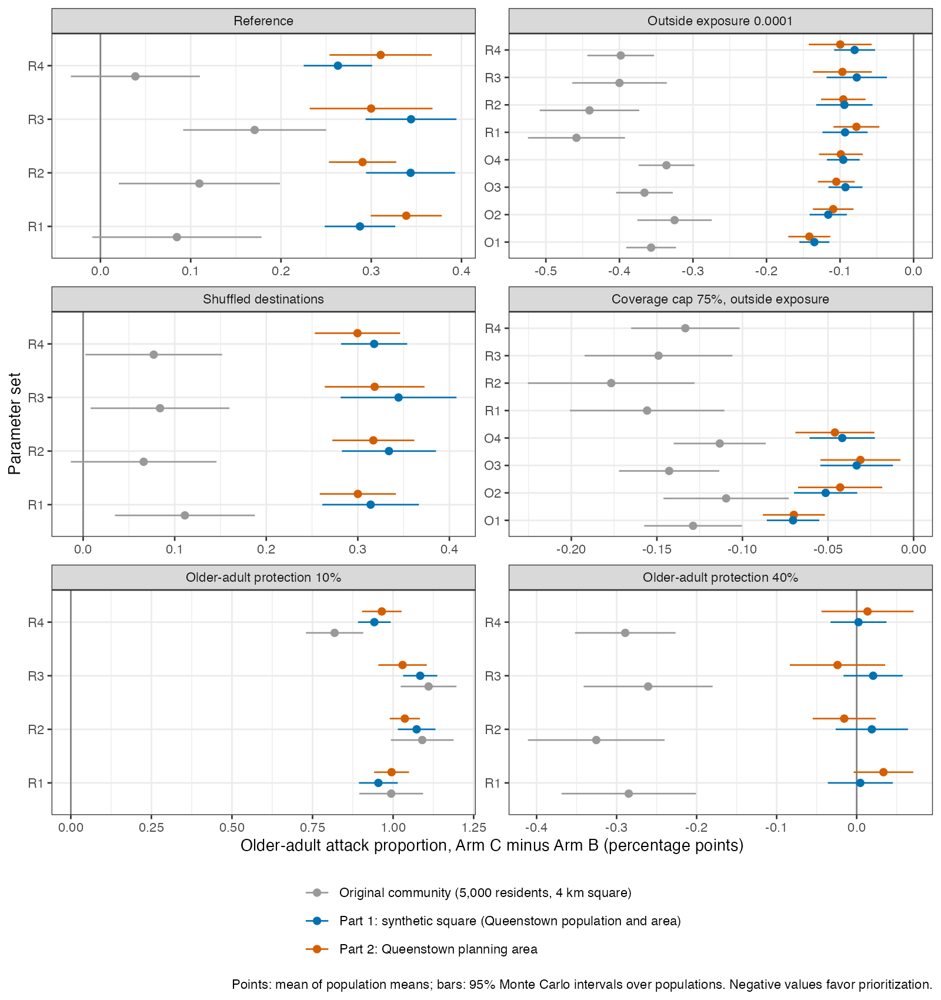

*Figure 10. Primary contrast, the older-adult attack proportion under Arm C (prioritization) minus that under Arm B (broad allocation), in the original community and the two full-scale geographies (a synthetic square and the real geography of the Queenstown planning area), by scenario and parameter set. The original community is shown for every set it ran in these scenarios, including sets not run at full scale. Points are means over populations; bars are 95% Monte Carlo intervals.*

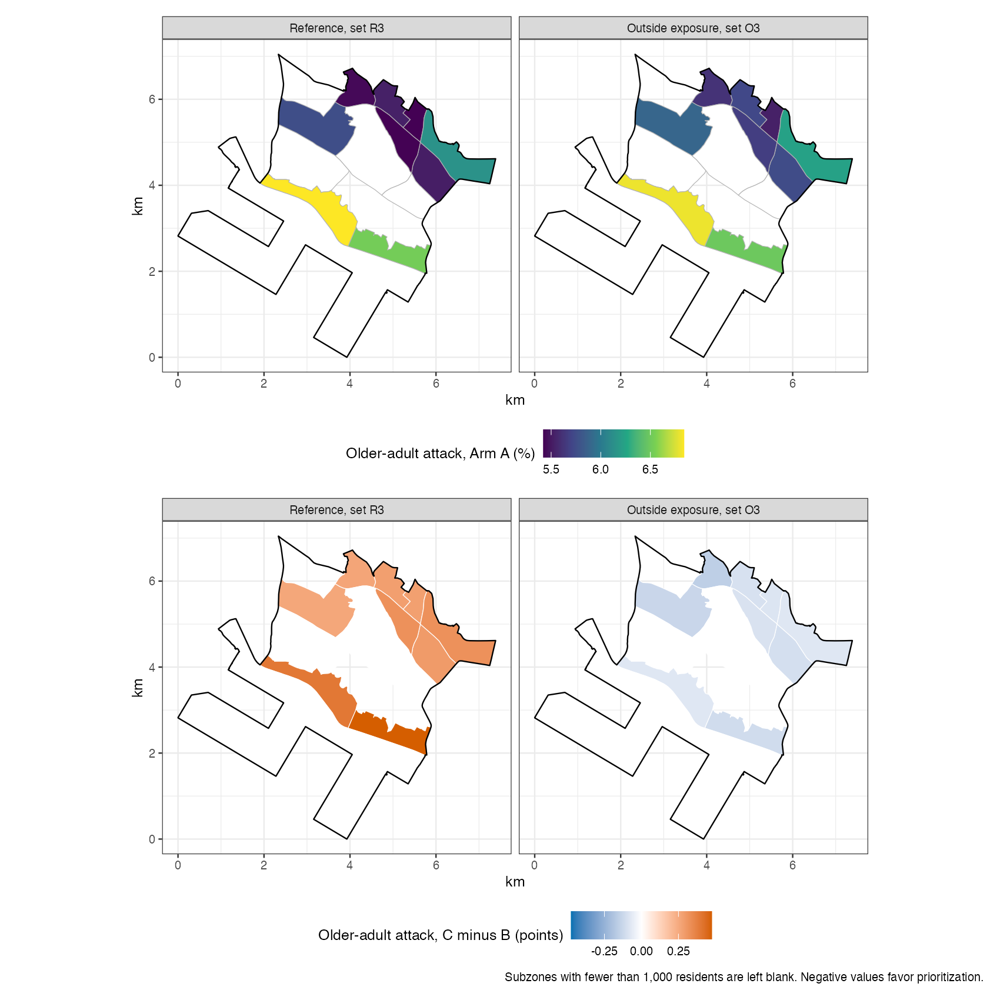

*Figure 11. Older-adult attack proportion under existing vaccination (top) and primary contrast, Arm C (prioritization) minus Arm B (broad allocation) (bottom), by subzone of the Queenstown planning area (Part 2), in the reference scenario (set R3) and with continued outside exposure (set O3). Subzones with fewer than 1,000 residents are left blank.*

## 4. Discussion

### Interpretation

In this synthetic Singapore community, which allocation protected older adults better depended more on the assumptions than on the allocation itself. Under the reference assumptions, the two campaigns protected older adults to within 0.2 percentage points of each other, with broad allocation slightly ahead. Prioritization was ahead when exposure from outside the community continued at 0.00005 per susceptible person-day or more, including in sets recalibrated with that exposure, when older adults were assumed to respond to the vaccine as well as younger adults, or when the vaccine protected younger adults less, and in both uncalibrated staying-home scenarios (25% and 75%). Broad allocation was ahead when older adults were assumed to gain little or no protection. Several of these scenarios were added post hoc and should be read as exploratory.

**Mechanism.** The two campaigns protected older adults through different routes. Broad allocation vaccinated about 360 adults under 65, who link homes to schools, workplaces and community venues. This lowered transmission enough to reduce the resident attack proportion by about a quarter and lowered the probability that the introduced infections produced a major outbreak, from 0.87 to 0.92 under Arm A to 0.76 to 0.83; in the reference scenario, its small advantage over prioritization was concentrated in the 7% to 10% of paired epidemics that became major outbreaks under prioritization but not under broad allocation. Prioritization vaccinated essentially every older adult without a baseline dose, about 358 people, with an assumed 30% reduction in susceptibility; in both arms, about a fifth of recipients were already immune. In pairs in which both arms had a major outbreak, the difference between the campaigns was −0.10 to +0.02 points, although this subgroup is defined by the outcome and the difference is not an effect estimate. When exposure from outside continued, nearly every epidemic became a major outbreak in every arm, and the protection given directly to older adults decided the comparison. Direct and indirect effects were not separated formally.

**Relation to two-group theory.** In a two-group model, direct vaccination of a vulnerable group was favored at high transmission and vaccination of transmitters at lower transmission (Dushoff et al., 2007). The present results agree with that model for vaccine protection: as protection in older adults fell relative to younger adults, broad allocation gained. They show no clear pattern for transmission intensity, however. Prioritization did slightly better than at the reference level both at the lower level (set L1, interval excluding zero) and in set H1 (interval including zero). Continued outside exposure favored prioritization, but it acts as a sustained external hazard that does not depend on local transmission, which the two-group model does not represent. In this model, local transmission intensity acted largely through the probability that an outbreak died out.

**Prespecified hypotheses.** Hypothesis 1 predicted that prioritization would protect older adults better under the reference assumptions. It was not supported: broad allocation was slightly ahead in the original community (0.04 to 0.17 points) and more clearly at full scale (0.26 to 0.34 points). As Hypothesis 1 also predicted, any advantage of prioritization shrank as older-adult protection was reduced. Hypothesis 2 was supported for continued outside exposure, which favored prioritization at every level from 0.00005 per day, but not for transmission intensity: across the calibrated levels there was no clear pattern, and the uncalibrated staying-home scenarios favored prioritization both when they enlarged the epidemics (25% staying home, by 1.01 to 1.26 points) and when they shrank them (75%, by 0.09 to 0.10 points). Hypothesis 3 was consistent in direction: broad allocation's advantage, where it existed, was larger for older adults living with their own children, someone under 18 or a domestic worker than for those living alone, most clearly at full scale.

**The tradeoff.** For the population as a whole, the comparison was not close. Broad allocation prevented more resident infections per dose under every assumption tested: 2.1 to 6.4 times as many, except with the coverage cap (1.25 to 1.32 times) and with adult protection of 20% (1.6 to 1.8 times). Where prioritization protected older adults better and the interval excluded zero, it averted 1.07 to 1.75 times as many older-adult infections as broad allocation.

**Scale and real geography.** Real geography reversed no comparison whose interval excluded zero. Placing the same Queenstown populations on real subzones, HDB blocks, private parcels, schools and venues changed the primary contrast by −0.05 to +0.05 points, with intervals up to 0.13 points from zero; against reference contrasts of 0.26 to 0.34 points, this is small but not negligible. Three influenza models with very different spatial structure gave qualitatively consistent rankings of pandemic interventions in the same setting (Halloran et al., 2008), and the allocation question here is not itself spatial. The original community and the full-scale populations differ in size, in the number of introductions (which scales with population: about 371 against 19), in age and household structure, and in whether Arm C could reach every older adult, so the changes between them cannot be attributed to scale alone. At full scale, the introductions almost always produced a major outbreak in every arm, so broad allocation's advantage in the reference scenario no longer depended on early extinction. It arose in outbreaks that occurred under both allocations, is consistent with the lower resident attack proportion under broad allocation (by 1.9 to 2.3 points), and grew with the number of people an older adult lived with, although direct and indirect effects were not separated. Under continued outside exposure, prioritization remained ahead in both full-scale parts, but by less than in the original community, and with older-adult protection equal to that of younger adults, the two allocations did not differ at full scale rather than favoring prioritization. The Queenstown population also differed from the national one: it is older, so Arm C could not reach every older adult with the same budget, and its households are smaller.

**Limits of these conclusions.**

*A small, closed community.* In the reference scenario, the community received about 19 introductions over five days and was then closed, and broad allocation's advantage depended on that closure. A 5,000-person part of Singapore is unlikely to be closed for four months, but the amount of outside exposure such a community receives is not known. In sets recalibrated with outside exposure of 0.0001 per day, prioritization was ahead by 0.33 to 0.37 points; the other exposure levels were not recalibrated.

*Near-threshold transmission.* The reference epidemics had an effective reproduction number of about 1.05 to 1.2, depending on the estimation window, at or below the lower quartile of published estimates for seasonal influenza (Biggerstaff et al., 2014). Indirect protection from vaccinating transmitters declined as the reproduction number rose in an earlier agent-based model (Basta et al., 2009), so broad allocation's advantage could be smaller in faster epidemics. In set H1, broad allocation's absolute benefit to older adults was larger, but its advantage over prioritization disappeared.

*Full older-adult uptake.* Arm C reached 100% coverage of adults aged 65 and over, which is optimistic. With coverage capped at 75%, the two arms differed in fewer doses, and prioritization's advantage under the open boundary fell to about a third, to 0.11 to 0.18 points.

*Outcomes and protection.* Older adults face a higher risk of severe outcomes per infection, so an allocation judged on hospitalization or death could differ. The assumed protection against infection in older adults was derived, not measured, and was the most influential single assumption.

*Uncertainty.* The Monte Carlo intervals reflect simulation error only; the substantive uncertainty lies in the spread of results across parameter sets and scenarios.

*The full-scale extension* was added after the main results, its parameter sets were not recalibrated, and it ran 16 populations with 10 epidemics per combination. Despite the smaller number of populations, its intervals (half-widths 0.02 to 0.08 points for the main scenarios) were no wider than those of the original community, because each full-scale epidemic was far less variable. A first run of the extension omitted the National University of Singapore campus (a name mismatch in the input derivation) and the supermarkets, and recorded older-adult infections by subzone incorrectly; all three were corrected, and all extension results reported here come from the corrected rerun. Part 1 placed 129 preschool sites, against 99 distinct preschool locations in Part 2, so preschool classes were slightly smaller in Part 1.

### Strengths of the agent-based approach

**Structure from data.** The model represents the structure on which the question depends: individual older adults in Census-matched households, including live-in domestic workers, linked through schools, workplaces and venues to the rest of the community. A compartmental model would have had to assume the mixing that this model generates from household and setting membership.

**Precise and verified comparisons.** Shared random numbers made the paired comparison precise: at the reference level, Monte Carlo standard errors were 0.03 to 0.05 points for contrasts whose epidemic-to-epidemic standard deviation was 1.3 to 1.6 points, although this precision concerns simulation error only. The automated tests and the course harness confirmed synchronous updating and conservation of S + I + R.

**Mechanisms that can be inspected.** Because every epidemic is paired across arms and every infection has a recorded setting and source, the model showed where the difference between the campaigns arose: in the epidemics that became major outbreaks under one arm but not the other and, under continued exposure, in infections acquired both inside and outside the community.

### Key assumptions and simplifications

**Transmission and natural history.** Transmission was calibrated to adult infection in Singapore's 2009 to 2011 epidemic waves of pandemic influenza, not to a seasonal epidemic. The 50% probability of staying home and the household contact structure were assumed; varying staying home without recalibration mainly changed the size of the epidemic, and both values tested (25% and 75%) reversed the reference ranking in favor of prioritization (Section 3.4). Infection timing came from young adults; because the incubation period was fixed, the serial interval equaled the generation interval, and the model's value of about 2.8 days is shorter than the serial interval observed in Hong Kong households. Calibration matched mean attack proportions including epidemics that died out, and the grid means had Monte Carlo standard errors of 1.2 to 1.6 points. Prior immunity was fixed at 20%.

**Vaccines.** Protection against infection at ages 18 to 64 was taken from challenge studies of young adults, and the older-adult value was derived from hospitalization outcomes. Vaccines reduced susceptibility only, not infectiousness.

**Population.** Coverage at ages 75 and over and in children was assumed and varied over its prespecified range (Section 3.4). Each household occupied its own dwelling. Nonresident household members other than domestic workers, and visitors to the home, were not represented. Floor area was assumed to be unrelated to family structure within household sizes.

### Limitations of time step, spatial scale and population size

**Time step.** The half-day step separates home from daytime settings but compresses each day's contacts into one step, and infectious periods are resolved only to 12 hours.

**Space.** The original community and Part 1 use stylized geography; Part 2 uses Queenstown's real subzones, housing and facilities. In all three, individuals keep fixed coordinates: distance acts only through which school, workplace and venue an individual joins, and contact with people elsewhere in Singapore enters only through the external hazard. No public table links planning area of residence to planning area of work, so commuting into and out of Queenstown could not be represented explicitly.

**Population size.** The original community of 5,000 residents is small enough that early extinction of outbreaks is common, and early extinction drove its reference result. Parts 1 and 2 hold the whole resident population of one planning area, about 102,000 individuals including domestic workers, but this is still a fortieth of Singapore's residents, and neither can show the nationwide indirect effects of a national campaign.

### Improving realism

**Realism.** The model would be more realistic with seasonal forcing and the regular introductions of a tropical setting; age-specific susceptibility and variable incubation periods; measured protection against infection in older adults; contact data for older adults and domestic workers; and an observation model linking infections to clinic visits, so that the model could be compared with national surveillance. A national model would also need data on commuting between planning areas.

## 5. Conclusion

In this agent-based model of influenza in Singapore, giving additional doses to adults aged 65 and over first, rather than spreading them across all adults, changed the older-adult attack proportion by less than 1 percentage point in most scenarios. The direction of the difference depended mainly on whether exposure from outside the community continued, which favored prioritization, and on how well the vaccine protects older adults relative to younger adults; the size of any advantage of prioritization also depended on how many older adults would accept vaccination. Without recalibration, both lower and higher proportions of symptomatic individuals staying home also favored prioritization. The results under the reference assumptions, with continued outside exposure and with weak older-adult protection kept their directions when the model was scaled to the whole population of the Queenstown planning area and placed on its real subzones, housing and facilities; the real geography changed the comparison by −0.05 to +0.05 points. At that scale, prioritization lost its advantage when older adults were assumed to be as well protected as younger adults, and under the reference assumptions, broad allocation's advantage was largest for older adults in households of five or more, with someone under 18, or with their children or a domestic worker (0.39 to 0.49 points, against 0.18 for those living alone; set R3). Broad allocation prevented more infections in the population as a whole under every assumption tested. The reported intervals describe simulation error only, and all results are conditional on the model and its parameter sets.

## References

Ansah JP, Matchar DB, Malhotra R, Love SR, Liu C, Do Y. Projecting the effects of long-term care policy on the labor market participation of primary informal family caregivers of elderly with disability: insights from a dynamic simulation model. BMC Geriatr. 2016;16:69. doi:10.1186/s12877-016-0243-0. PMID: 27007720.

Barua R, Shastry GK, Yang D. Financial education for female foreign domestic workers in Singapore. Econ Educ Rev. 2020;78:101920. doi:10.1016/j.econedurev.2019.101920. PMID: 39371084.

Basta NE, Halloran ME, Matrajt L, Longini IM Jr. Estimating influenza vaccine efficacy from challenge and community-based study data. Am J Epidemiol. 2008;168(12):1343-52. doi:10.1093/aje/kwn259. PMID: 18974084.

Basta NE, Chao DL, Halloran ME, Matrajt L, Longini IM Jr. Strategies for pandemic and seasonal influenza vaccination of schoolchildren in the United States. Am J Epidemiol. 2009;170(6):679-86. doi:10.1093/aje/kwp237. PMID: 19679750.

Biggerstaff M, Cauchemez S, Reed C, Gambhir M, Finelli L. Estimates of the reproduction number for seasonal, pandemic, and zoonotic influenza: a systematic review of the literature. BMC Infect Dis. 2014;14:480. doi:10.1186/1471-2334-14-480. PMID: 25186370.

Carrat F, Vergu E, Ferguson NM, Lemaitre M, Cauchemez S, Leach S, et al. Time lines of infection and disease in human influenza: a review of volunteer challenge studies. Am J Epidemiol. 2008;167(7):775-85. doi:10.1093/aje/kwm375. PMID: 18230677.

Chao DL, Halloran ME, Obenchain VJ, Longini IM Jr. FluTE, a publicly available stochastic influenza epidemic simulation model. PLoS Comput Biol. 2010;6(1):e1000656. doi:10.1371/journal.pcbi.1000656. PMID: 20126529.

Chen MI, Cook AR, Lim WY, Lin R, Cui L, Barr IG, et al. Factors influencing infection by pandemic influenza A(H1N1)pdm09 over three epidemic waves in Singapore. Influenza Other Respir Viruses. 2013;7(6):1380-9. doi:10.1111/irv.12129. PMID: 23829633.

Cowling BJ, Fang VJ, Riley S, Peiris JSM, Leung GM. Estimation of the serial interval of influenza. Epidemiology. 2009;20(3):344-7. doi:10.1097/EDE.0b013e31819d1092. PMID: 19279492.

De Roza JG, Chan CY, Chua M, Ong HC, Goh LJ. Social support and associated factors among community-dwelling older adults in Singapore: a cross-sectional study. BMC Geriatr. 2026;26(1). doi:10.1186/s12877-026-07661-x. PMID: 42135642.

Dickens BL, Koo JR, Lim JT, Park M, Quaye S, Sun H, et al. Modelling lockdown and exit strategies for COVID-19 in Singapore. Lancet Reg Health West Pac. 2020;1:100004. doi:10.1016/j.lanwpc.2020.100004. PMID: 34173590.

Dushoff J, Plotkin JB, Viboud C, Simonsen L, Miller M, Loeb M, et al. Vaccinating to protect a vulnerable subpopulation. PLoS Med. 2007;4(5):e174. doi:10.1371/journal.pmed.0040174. PMID: 17518515.

Early Childhood Development Agency. Pre-Schools Location (data.gov.sg d_61eefab99958fd70e6aab17320a71f1c). Accessed 19 November 2026.

Ferguson NM, Cummings DA, Cauchemez S, Fraser C, Riley S, Meeyai A, et al. Strategies for containing an emerging influenza pandemic in Southeast Asia. Nature. 2005;437(7056):209-14. doi:10.1038/nature04017. PMID: 16079797.

Grimm V, Railsback SF, Vincenot CE, Berger U, Gallagher C, DeAngelis DL, et al. The ODD protocol for describing agent-based and other simulation models: a second update to improve clarity, replication, and structural realism. J Artif Soc Soc Simul. 2020;23(2):7. doi:10.18564/jasss.4259.

Halloran ME, Ferguson NM, Eubank S, Longini IM Jr, Cummings DA, Lewis B, et al. Modeling targeted layered containment of an influenza pandemic in the United States. Proc Natl Acad Sci U S A. 2008;105(12):4639-44. doi:10.1073/pnas.0706849105. PMID: 18332436.

Harland K, Heppenstall A, Smith D, Birkin M. Creating realistic synthetic populations at varying spatial scales: a comparative critique of population synthesis techniques. J Artif Soc Soc Simul. 2012;15(1):1. doi:10.18564/jasss.1909.

Housing and Development Board. HDB Property Information (data.gov.sg d_17f5382f26140b1fdae0ba2ef6239d2f). Accessed 19 November 2026. Block addresses geocoded with the OneMap search API (Singapore Land Authority, https://www.onemap.gov.sg).

Koo JR, Cook AR, Park M, Sun Y, Sun H, Lim JT, et al. Interventions to mitigate early spread of SARS-CoV-2 in Singapore: a modelling study. Lancet Infect Dis. 2020;20(6):678-88. doi:10.1016/S1473-3099(20)30162-6. PMID: 32213332.

Kua JA, Pang J. The epidemiological risk factors of hand, foot, mouth disease among children in Singapore: a retrospective case-control study. PLoS One. 2020;15(8):e0236711. doi:10.1371/journal.pone.0236711. PMID: 32780749.

Lovelace R, Birkin M, Ballas D, van Leeuwen E. Evaluating the performance of iterative proportional fitting for spatial microsimulation: new tests for an established technique. J Artif Soc Soc Simul. 2015;18(2):21. doi:10.18564/jasss.2768.

Ministry of Education. General information of schools (data.gov.sg d_688b934f82c1059ed0a6993d2a829089). Accessed 19 November 2026.

Ministry of Health and Health Promotion Board, Singapore. National Population Health Survey 2024: Survey Report. Chapter 8, Tables 8.1 and 8.2. https://go.gov.sg/nphs-2024. Accessed 19 November 2026.

Morris TP, White IR, Crowther MJ. Using simulation studies to evaluate statistical methods. Stat Med. 2019;38(11):2074-102. doi:10.1002/sim.8086. PMID: 30652356.

National Environment Agency. Hawker Centres (data.gov.sg d_4a086da0a5553be1d89383cd90d07ecd); List of Supermarket Licences (data.gov.sg d_11edd0117280c5776651d7891114c88c). People's Association. Community Clubs (data.gov.sg d_f706de1427279e61fe41e89e24d440fa). Accessed 19 November 2026.

Prem K, van Zandvoort K, Klepac P, Eggo RM, Davies NG, CMMID COVID-19 Working Group, et al. Projecting contact matrices in 177 geographical regions: an update and comparison with empirical data for the COVID-19 era. PLoS Comput Biol. 2021;17(7):e1009098. doi:10.1371/journal.pcbi.1009098. PMID: 34310590. Correction: PLoS Comput Biol. 2024;20(9):e1012454. doi:10.1371/journal.pcbi.1012454. PMID: 39292734.

Rondy M, El Omeiri N, Thompson MG, Levêque A, Moren A, Sullivan SG. Effectiveness of influenza vaccines in preventing severe influenza illness among adults: a systematic review and meta-analysis of test-negative design case-control studies. J Infect. 2017;75(5):381-94. doi:10.1016/j.jinf.2017.09.010. PMID: 28935236.

Singapore Department of Statistics. Census of Population 2020 tables via data.gov.sg: resident population by age and sex (d_d95ae740c0f8961a0b10435836660ce0); resident households by household structure and size (d_5878c7d334eb84983a765d91bd270d7c); household size and floor area (d_46ff0d0429b30ac8d76d6778df32eb84); residents aged 65 and over by living arrangement (d_df70e7fa7d362c880d9647440f67babf); married couples by age (d_cadd4d2df56ac4187847648f44ffcb9c); students by level (d_b19c5bc4f6916b5481f6531918440fe6); resident households by planning area and household size (d_0ef47f84a0776b27010b242038ea2c6b); resident households by planning area and type of dwelling (d_388f9c61f437a588b47b008a012d13fa); employed residents by planning area of workplace (d_22063c84778e6535b92b4d8f93fd2525); labour force status by planning area (d_e9b1f437263fceebc0c1f0e60cd7b0f0); resident population by subzone and type of dwelling (d_7f243956483d5901f237e6f87b096636). SingStat Table Builder tables C030030, C010023 and M810821. Resident households: our data explained. Accessed 19 November 2026.

Stout NK, Goldie SJ. Keeping the noise down: common random numbers for disease simulation modeling. Health Care Manag Sci. 2008;11(4):399-406. doi:10.1007/s10729-008-9067-6. PMID: 18998599.

Tsang TK, Fang VJ, Ip DKM, Perera RAPM, So HC, Leung GM, et al. Indirect protection from vaccinating children against influenza in households. Nat Commun. 2019;10(1):106. doi:10.1038/s41467-018-08036-6. PMID: 30631062.

Tsang TK, Wang C, Fang VJ, Perera RAPM, So HC, Ip DKM, et al. Reconstructing household transmission dynamics to estimate the infectiousness of asymptomatic influenza virus infections. Proc Natl Acad Sci U S A. 2023;120(33):e2304750120. doi:10.1073/pnas.2304750120. PMID: 37549267.

Urban Redevelopment Authority. Master Plan 2019 Subzone Boundary (No Sea), Planning Area Boundary (No Sea) and Land Use layer (data.gov.sg d_8594ae9ff96d0c708bc2af633048edfb, d_4765db0e87b9c86336792efe8a1f7a66 and d_90d86daa5bfaa371668b84fa5f01424f). Accessed 19 November 2026.

Wallinga J, Lipsitch M. How generation intervals shape the relationship between growth rates and reproductive numbers. Proc Biol Sci. 2007;274(1609):599-604. doi:10.1098/rspb.2006.3754. PMID: 17476782.

Young BE, Mak TM, Ang LW, Sadarangani S, Ho HJ, Wilder-Smith A, et al. Influenza vaccine failure in the tropics: a retrospective cohort study of waning effectiveness. Epidemiol Infect. 2020;148:e299. doi:10.1017/S0950268820002952. PMID: 33261680.

Yue M, Dickens BL, Yoong JS, Chen MIC, Teerawattananon Y, Cook AR. Cost-effectiveness analysis for influenza vaccination coverage and timing in tropical and subtropical climate settings: a modeling study. Value Health. 2019;22(12):1345-54. doi:10.1016/j.jval.2019.07.001. PMID: 31806190.

Zahari M, Offeddu V, Smith GJD, Tam CC. Determinants of influenza and pneumococcal vaccine uptake among preschool children in Singapore. PLoS One. 2023;18(5):e0285561. doi:10.1371/journal.pone.0285561. PMID: 37196045.

## Appendix A. Output of `abm_check()` on the submitted model

The harness was run through an adapter (`model/R/abm_check_adapter.R`), because it was written for the teaching model. The adapter maps the harness's zero-transmission parameters to zero transmission inside the community and zero external exposure. The harness counts individuals who start in R (prior immunity) as "infected at the start".

```
abm_check() on world 1 (Arm C unless stated), tau = 0.30, h = 1.0, t_max = 310 half-day steps
population is conserved at every step                ok   min 5255, max 5255, expected 5255
recovered count never falls                          ok   smallest change 0
susceptible count never rises                        ok   largest change 0
same seed reproduces the run                         ok   compared S, I and R at every step
a different seed changes the run                     ok   final size 1639 against 1118
zero transmission probability infects nobody         ok   1017 infected at the start, 1017 ever infected
agents stay inside the box                           ok   0 agents outside
agents do not pile up on the wall                    ok   0 agents sitting exactly on a boundary
population is conserved under broad adult allocation (Arm B) ok   min 5255, max 5255, expected 5255
recovered count never falls under broad adult allocation (Arm B) ok   smallest change 0
population is conserved under existing vaccination only (Arm A) ok   min 5255, max 5255, expected 5255
recovered count never falls under existing vaccination only (Arm A) ok   smallest change 0
population is conserved under open boundary          ok   min 5255, max 5255, expected 5255
recovered count never falls under open boundary      ok   smallest change 0

14 of 14 checks passed
```

## Appendix B. Model description (Overview, Design concepts and Details protocol)

This description follows the Overview, Design concepts and Details (ODD) protocol for describing individual-based and agent-based models, in its second update (Grimm et al., 2020). It describes what the code in `model/R/` does; Section B8 maps every element to the code.

### B1. Purpose and patterns

The model compares two ways of allocating the same number of additional influenza vaccine doses in a Singapore population: to adults aged 65 and over first, or across all adults aged 18 and over. Both are added to existing age-specific vaccination. The primary output is the infection attack proportion among residents aged 65 and over during one 120-day wave. The model also shows how that comparison varies with older adults' household composition, including live-in foreign domestic workers, with transmission intensity, vaccine protection, exposure from outside the population and spatial structure.

The model is run on three geographies, which share every rule except where homes and destinations are placed:

- **Original community.** About 5,000 residents built from national Census 2020 tables, in a synthetic 4 km by 4 km square with four equal neighborhoods.
- **Part 1, synthetic square.** The resident population of the Queenstown planning area (95,930 residents in Census 2020), synthesized to Queenstown's age, sex and household-size distributions, in a synthetic square of Queenstown's land area (21.7 km²) with one neighborhood per populated Queenstown subzone (13).
- **Part 2, Queenstown.** The same synthetic populations placed on the real geography of the Queenstown planning area: Urban Redevelopment Authority Master Plan 2019 subzones, Housing and Development Board (HDB) residential blocks, private residential parcels, real school, preschool and tertiary sites, hawker centers, community clubs and supermarkets.

The model is judged fit for this purpose if it reproduces the following patterns.

- **Population.** The Census 2020 distributions of resident age and sex, household structure by size, and older adults' living arrangement by age; in Parts 1 and 2 also Queenstown's household-size distribution, and in Part 2 Queenstown's residents by subzone and age, residents by subzone and dwelling type, and households by dwelling type. Acceptance: standardized absolute error below 0.10 in every fitted table.
- **Adult infection.** The infection attack proportion among unvaccinated adults aged 21 to 75 in Singapore's 2009 pandemic waves. Acceptance: 11.5% to 15.5% at the reference level and 5.0% to 8.0% at the lower level.
- **Generation interval.** Acceptance: 2.1 to 3.0 days.
- **Household serial interval.** Acceptance: 2.9 to 4.3 days.

The model does not reproduce the serial interval pattern. Because the incubation period is fixed, the mean serial interval equals the mean generation interval, about 2.8 to 2.9 days.

### B2. Entities, state variables and scales

**Individuals** are residents and live-in foreign domestic workers. Each has:

- unique identifier, household identifier, sex and age;
- resident flag and domestic-worker flag;
- role links to spouse and parent;
- living arrangement if aged 65 or over, and severe difficulty in a basic activity (used only to place domestic workers);
- fixed home coordinates and neighborhood (subzone in Part 2);
- education level, school site and class, if a student;
- workplace, if employed;
- community venue site and venue group;
- rest-day gathering group, if a domestic worker;
- age band of the contact matrices (5-year bands, 0 to 4 through 75 and over);
- disease state, infection step and symptomatic flag;
- baseline vaccination;
- additional dose day.

**Households** have size class and family structure; occupants, residents and domestic-worker flag; floor area and floor area per occupant; neighborhood and coordinates; and in Part 2 a dwelling type (HDB 1 and 2 room, 3 room, 4 room, 5 room and executive, condominium or other apartment, landed property) and, for HDB households, the block.

**Settings** are classes at school sites, workplaces, community-venue groups at venue sites and the domestic workers' rest-day gathering groups. Group sizes are the same in all three geographies: classes of up to 15 (preschool), 30 (primary and secondary) or 50 (tertiary) students, a mean of 10 workers per workplace, venue groups of about 125 regular users and gathering groups of about 250 domestic workers. A real venue such as a hawker center therefore hosts several venue groups.

**Space** is two-dimensional in meters: a bounded square in the original community and Part 1, and Singapore's SVY21 projected coordinates (EPSG:3414) in Part 2. Individuals do not move between coordinates; distance determines which workplace, venue site and secondary or tertiary site an individual joins, and the nearest preschool and primary site.

**Time** advances in half-day steps: an even step is daytime and an odd step is nighttime. A run lasts 155 days (310 steps), and day 0 is a Monday. Half-day steps separate daytime settings (school, work and community) from the household at night, as in other influenza individual-based models (Chao et al., 2010), and are short relative to the 2.6-day mean generation interval.

**Disease states** are S (susceptible), I (infected and not yet recovered, including the latent period) and R (recovered or immune). Infectiousness is a function of infection age within I and is recorded separately.

### B3. Process overview and scheduling

Each step runs the same sequence (`simulate_arm`, `R/model.R`):

1. Vaccine protection that begins today is applied.
2. Disease states are frozen. Infectiousness is computed from each infected individual's infection age, with a lower weight if the infection is asymptomatic.
3. Individuals are placed for the step.
   - **Night:** everyone is at home.
   - **Weekday daytime:** students are at their class and employed adults at their workplace. Everyone not staying home, and not at a domestic workers' gathering, also visits their venue group. Individuals not at school, work or a gathering are at home.
   - **Weekends:** there is no school or work.
   - **Sunday daytime:** domestic workers who take their rest day attend their gathering group.
   - **Staying home:** symptomatic individuals who stay home do so from symptom onset to recovery.
4. Each susceptible individual's hazard from each setting is computed from the frozen infectious individuals present in that setting, and the external hazard is added.
5. One infection draw per susceptible individual, made with a pre-drawn uniform random number.
6. All transitions are committed at once: I to R at the end of the infectious period, and S to I for new infections. The setting of each new infection is attributed in proportion to the setting hazards. Its infector is drawn among infectious individuals in that setting, in proportion to their contributions.
7. Counts are recorded, and S + I + R = N is checked.

An individual infected in a step cannot transmit until a later step.

### B4. Design concepts

- **Basic principles.** The model is a stochastic individual-based transmission model in which contacts occur within shared, persistent settings. Vaccination reduces susceptibility to infection.
- **Emergence.** Attack proportions by age, household type and subzone, epidemic timing, the generation interval, the share of infections by setting and spatial spread arise from individual infections in settings and are not imposed.
- **Adaptation, objectives, learning and prediction.** None.
- **Sensing.** None. Staying home depends only on an individual's own symptoms.
- **Interaction.**
  - **Household:** per-pair intensity h divided by (household size minus 1) to the power 0.5.
  - **School and workplace:** frequency-dependent among those present, at the Prem et al. contact rates per attendee.
  - **Community:** age-structured using the Prem et al. "other locations" matrix for Singapore, made reciprocal for the synthetic population and spread across the members of each age band in the same venue group.
  - **Domestic workers' gathering:** frequency-dependent among the domestic workers present in the same gathering group.
- **Stochasticity.** Population synthesis, placement, setting assignment, prior immunity, baseline vaccination, the dose-queue order, symptoms, staying home, infection, setting attribution, infector choice and domestic workers' rest days are random. For each epidemic, all of these except population synthesis, placement and setting assignment are drawn once and shared by Arms A, B and C.
- **Collectives.** Households, classes, workplaces, venue groups, gathering groups and neighborhoods.
- **Observation.** Per step: S, I and R counts, infectious prevalence and new infections. Per individual: infection step, setting and infector. Per arm: summary outcomes, attack proportions for older adults by household stratum and attack proportions by neighborhood.

### B5. Initialization

#### Population synthesis

`synthesize_population` (`R/population.R`) is a sample-free synthetic reconstruction followed by simulated annealing over whole households.

1. **Candidate households** are generated for every structure-by-size cell of the national Census 2020 table, from role templates. Couple ages come from the Census joint distribution of husband's and wife's age groups; children follow mother-to-child gaps of 20 to 42 years; grandparents follow generation gaps of 20 to 40 years.
2. **Domestic workers.** Each candidate exists with and without a domestic worker, who occupies one place within the published household size, because the Census counts live-in domestic workers as household members. The prior probability of a domestic worker is the observed 2020 share by age group for an older adult with no co-resident family, 0.49 if an older resident has severe difficulty, 0.25 if a child under 6 is present and 0.12 otherwise.
3. **Selection.** Simulated annealing (400,000 proposed swaps) selects whole households to fit household structure by size, resident age and sex, older adults' living arrangement by age, and the observed 15.8% of households with a domestic worker. In the original community the targets are national and the population has about 1,630 households and 5,000 residents. In Parts 1 and 2 the targets are Queenstown's: 95,930 residents with Queenstown's age and sex distribution, and 37,052 households with Queenstown's household-size distribution (the sum of the Census 2020 household-size cells), within which household structure follows the national distribution for each size. A population is accepted only if every fitted table has a standardized absolute error below 0.10.
4. **Floor area** in the original community and Part 1 is drawn from the national Census 2020 floor-area band distribution for the household's size, uniformly within the band. This assumes that floor area depends on household size only, not on income or location. In Part 2, floor area follows the dwelling type at the household's address (placement, below).

#### Placement and settings

**Original community** (`assign_settings`, `R/settings.R`): households are placed uniformly in a random quadrant of a 4 km square. Each quadrant has one preschool and primary site; two secondary sites serve the west and east halves; one tertiary site serves everyone. Each worker chooses one of about 270 workplaces (one per 10 workers, placed uniformly) with weights $\exp(-d/1\,\mathrm{km})$, with $d$ the distance, and everyone chooses one of 40 venues with the same kernel.

**Part 1, synthetic square** (`square_layout`, `assign_settings_layout`, `R/geography.R`): a square of 21.7 km² (4.66 km side) with 13 neighborhoods, formed as the Voronoi cells of 13 random centers so that neighborhoods differ in size as subzones do. Households, school sites, venue sites and workplaces are placed uniformly at random, with the same numbers of preschool, primary, secondary, tertiary and venue sites as in Part 2.

**Part 2, Queenstown** (`queenstown_layout`, `R/queenstown.R`):

1. **Subzone and dwelling type.** A second annealing step assigns each household to a subzone and a dwelling type so that the population matches, at once, Queenstown's residents by subzone and 5-year age band, residents by subzone and dwelling type, and households by dwelling type (Census 2020).
2. **Address.** An HDB household is placed at an HDB residential block in its subzone, chosen in proportion to the block's number of flats of the household's type (HDB Property Information, geocoded with OneMap), with a random offset of up to 15 m in each coordinate. A household in a condominium, other apartment or landed property is placed at a random point on a private residential parcel of its kind in its subzone: Master Plan 2019 residential parcels with no HDB block within 20 m, sampled in proportion to parcel area times gross plot ratio, with parcels zoned for landed housing taken as landed.
3. **Floor area** is drawn uniformly within the range for the dwelling type: HDB 1 and 2 room 30 to 47 m², 3 room 60 to 75 m², 4 room 85 to 105 m², 5 room and executive 105 to 150 m², condominium 60 to 150 m² and landed 150 to 400 m² (the private ranges are assumed).
4. **Destinations.** School sites are the Ministry of Education primary and secondary schools and junior colleges within 1 km of Queenstown and the preschools within 500 m, geocoded by postal code; the tertiary sites are Anglo-Chinese Junior College, the National University of Singapore (Kent Ridge) campus and the Singapore Polytechnic campus. Workplaces are placed at points on parcels zoned for business, commerce (including mixed residential-commercial and white sites), institutions, places of worship, health care, education, sports and recreation, utilities, transport, special use and the port, in proportion to parcel area times plot ratio. Venue sites are the existing hawker centers and the community clubs within 300 m of Queenstown and the licensed supermarkets inside it.

**Shared rules in Parts 1 and 2:**

- **Education:** ages 3 to 6 attend preschool with probability 0.704; ages 7 to 16 attend school; ages 17 to 24 attend tertiary education with probability 0.652. Preschool and primary pupils attend their nearest site of that level, because primary school admission in Singapore gives priority by home distance. Secondary and tertiary students choose a site with weights $\exp(-d/1\,\mathrm{km})$, with $d$ the distance. Classes are formed by site, level and single year of age.
- **Work:** residents aged 15 and over who are not students work with their 2020 labor force participation rate by sex and age, at one of the workplaces (one per 10 workers) chosen with weights $\exp(-d/1\,\mathrm{km})$, with $d$ the distance.
- **Community:** everyone chooses a venue site with the same kernel and is assigned at random to one of its venue groups.
- **Gatherings:** domestic workers are divided at random into gathering groups of about 250.

All workplaces, schools and venues are inside or next to the modeled area. Contacts with people who live elsewhere, including at workplaces outside the area, are represented by the external hazard.

#### Per epidemic

`draw_streams` and `simulate_arm`, `R/model.R`:

- 20% of individuals start in R (prior immunity).
- Baseline vaccination follows age-specific coverage from the National Population Health Survey 2024 for adult bands, 52.6% for ages 75 and over, 8% under 18 and 0% for domestic workers.
- No individual is infected at day 0.

### B6. Input data

| Input | Source | Use |
| --- | --- | --- |
| Resident age and sex, national, planning area and subzone | Census 2020, data.gov.sg d_d95ae740c0f8961a0b10435836660ce0 | Fitted |
| Household structure by size | Census 2020, d_5878c7d334eb84983a765d91bd270d7c | Fitted |
| Household size by floor area | Census 2020, d_46ff0d0429b30ac8d76d6778df32eb84 | Floor area given size |
| Older adults' living arrangement by age | SingStat M810821, 2020 | Fitted |
| Older adults' living arrangement by difficulty | Census 2020, d_df70e7fa7d362c880d9647440f67babf | Severe-difficulty rates |
| Married couples by age | Census 2020, d_cadd4d2df56ac4187847648f44ffcb9c | Spouse ages |
| Labor force participation | Ministry of Manpower, d_465c5bd4a9adae523f9577371daf5e24, 2020 | Employment |
| Students by level | Census 2020, d_b19c5bc4f6916b5481f6531918440fe6 | Enrollment rates |
| Households with a domestic worker | SingStat C030030, 2020 | 15.8% target |
| Older adults living only with a domestic worker | SingStat C010023 and M810821 | Domestic worker allocation |
| Vaccination coverage | National Population Health Survey 2024, Table 8.1 | Baseline vaccination |
| Contact matrices | Prem et al. 2021, corrected 2024 | Age mixing and contact rates |
| Households by size, planning area | Census 2020, d_0ef47f84a0776b27010b242038ea2c6b | Part 1 and 2 targets |
| Households by dwelling type, planning area | Census 2020, d_388f9c61f437a588b47b008a012d13fa | Part 2 targets |
| Residents by dwelling type, subzone | Census 2020, d_7f243956483d5901f237e6f87b096636 | Part 2 targets |
| Subzone and planning-area boundaries | Urban Redevelopment Authority Master Plan 2019 (no sea), d_8594ae9ff96d0c708bc2af633048edfb and d_4765db0e87b9c86336792efe8a1f7a66 | Part 2 geography |
| Land use | URA Master Plan 2019 land use, d_90d86daa5bfaa371668b84fa5f01424f | Private dwellings and workplaces |
| HDB blocks and flats by type | HDB Property Information, d_17f5382f26140b1fdae0ba2ef6239d2f, geocoded with OneMap | Part 2 addresses |
| Schools | Ministry of Education, d_688b934f82c1059ed0a6993d2a829089, geocoded with OneMap | Part 2 school sites |
| Preschools | Early Childhood Development Agency, d_61eefab99958fd70e6aab17320a71f1c | Part 2 preschool sites |
| Hawker centers, community clubs, supermarkets | National Environment Agency d_4a086da0a5553be1d89383cd90d07ecd; People's Association d_f706de1427279e61fe41e89e24d440fa; National Environment Agency supermarket licenses d_11edd0117280c5776651d7891114c88c, geocoded with OneMap | Part 2 venue sites |

Every file is stored in `planning-evidence/` with its source URL, retrieval date and SHA-256 hash. The tabular readers verify the hash before use. The Queenstown spatial inputs are converted once into model-ready tables by `scripts/data/derive_queenstown.R`, which records the hashes of its inputs and outputs. No input changes during a run.

### B7. Submodels

**Natural history.**

- Infectiousness over infection age follows a gamma density with mean 2.6 days and standard deviation 1.1 days, is zero for the first day (the latent period), is truncated at 8 days, when the individual recovers, and is normalized to a total of one unit.
- 67% of infections become symptomatic, at infection age 1.5 days. Never-symptomatic infections are 0.57 times as infectious.
- Half of symptomatic individuals stay home from onset until recovery.

**Transmission.**

- For susceptible individual $i$, the probability of infection in a step of length 0.5 days is $P_i = 1 - \exp\{-0.5\, s_i (\sum_k \lambda_{ik} + \lambda_{\mathrm{ext}})\}$, where $s_i$ is residual susceptibility after vaccination and $\lambda_{ik}$ is the hazard from infectious individuals present with $i$ in setting $k$.
- School, workplace, community and gathering hazards represent a day's contacts and are applied at twice their daily rate during the daytime step.
- The transmission scale τ and household intensity h are calibrated in the original community. Sets R1 to R4 (reference level), L1 and L2 (lower level), H1 (higher transmission, not calibrated) and O1 to O4 (calibrated with continued external exposure of 0.0001 per day and used only with that exposure) are reported separately. Parts 1 and 2 use sets R1 to R4 and O1 to O4 without recalibration; their adult attack proportions under existing vaccination are reported as a check.

**External exposure.** The external hazard represents infection acquired from people outside the modeled population, including importations. In the reference scenario it is 0.001 per susceptible-day on days 35 to 39 and zero otherwise, so the wave is seeded by importations and then sustained by local transmission. In the open-boundary scenarios it continues at 0.0001 per day after day 39 (and at 0.00002, 0.00005 or 0.0002 in added scenarios of the original community).

**Vaccination.**

- Protection is a proportional reduction in susceptibility of 40% (ages 18 to 64), 30% (65 and over) or 50% (under 18). Baseline protection is multiplied by 0.91 for waning.
- **Budget:** 10 additional doses per 100 resident adults, rounded down, given in equal daily numbers on days 7 to 20 to eligible residents aged 18 and over without a baseline dose. Each dose protects from 14 days after it is given.
- **Order:** Arm B follows one shared random ordering of all eligible adults. Arm C takes every eligible resident aged 65 and over first, in that same order, and gives any remaining doses to younger adults in the same order. Doses given to individuals already infected or immune count against the budget.
- **Uptake cap:** in the uptake-cap scenarios, residents aged 65 and over are removed from the queue in every arm once baseline and campaign doses together would cover more than 75% of them; their places pass to younger adults, so both arms still give the same number of doses.

**Living space** (original community only). With γ greater than 0, a household's pair intensity is multiplied by (median area per occupant / household area per occupant)^γ, bounded to 0.5 to 2 and normalized to a mean of 1 weighted by occupant pairs.

**Shuffled destinations.** Workplace memberships are permuted among workers, venue memberships among all individuals and class memberships among students of the same level and age. This preserves every group's size, and the age composition of classes, while breaking the link between home location and destination.

### B8. Code map

| Element | File and function |
| --- | --- |
| Input data and checksum verification | `R/data_inputs.R`: `read_evidence_records`, `read_age_sex`, `load_inputs` |
| Population synthesis | `R/population.R`: `generate_pool`, `anneal_select`, `fit_report`, `synthesize_population` |
| Original community geography and settings | `R/settings.R`: `assign_settings`, `shuffle_destinations`, `contact_rates` |
| Parts 1 and 2 settings, Part 1 layout | `R/geography.R`: `assign_settings_layout`, `square_layout` |
| Part 2 layout | `R/queenstown.R`: `queenstown_inputs`, `assign_cells`, `queenstown_layout`; `scripts/data/derive_queenstown.R` |
| Scheduling and transmission | `R/model.R`: `simulate_arm`, `infectiousness_profile`, `dose_queue`, `draw_infectors` |
| Random numbers shared across arms | `R/model.R`: `draw_streams` |
| Outcomes | `R/experiment.R`: `arm_outcomes`, `stratum_outcomes`, `neighborhood_outcomes`, `run_task` |
| Course harness adapter | `R/abm_check_adapter.R` |
| Scenarios and parameter sets | `scripts/scenarios.R` |
| Simulation experiments | `scripts/calibrate.R`, `scripts/run_experiment.R`, `scripts/build_worlds_ext.R`, `scripts/run_extension.R`, `scripts/analyze.R`, `scripts/analyze_ext.R` |
| Verification tests | `tests/testthat/` |

## Appendix C. Reproducibility

The code, the input tables with their checksums and provenance records, and the summary outputs are publicly available at https://github.com/ansellim/singapore-flu-vaccine-abm, whose README gives the same steps with installation instructions. The runs can be reproduced on a server with the following commands:

1. `Rscript scripts/build_worlds.R 30`
2. `Rscript scripts/calibrate.R 5 10` and, for sets O1 to O4, `Rscript scripts/calibrate.R 5 10 open`
3. `Rscript scripts/pilot.R 10 10`
4. `Rscript scripts/run_experiment.R 30 50`
5. `Rscript scripts/analyze.R`
6. `Rscript scripts/figure_spatial.R 1 R3`
7. `Rscript scripts/run_abm_check.R <course setup.R> <world rds> 0.30 1.0`
8. `Rscript scripts/data/derive_queenstown.R` (run once where the R package sf is installed; writes the Queenstown model inputs)
9. `Rscript scripts/build_worlds_ext.R 16`
10. `Rscript scripts/run_extension.R 1 16 10` (the analyzed runs split the populations across three machines with the same command and population ranges 1 to 10, 11 to 13 and 14 to 16)
11. `A4_MAP_POP=1 Rscript scripts/analyze_ext.R 16`

Run them from `model/`. The verification tests run with `Rscript tests/testthat.R`.

## Code availability and AI assistance statement

All code, input data with provenance records, summary outputs and the documents produced during the study (literature reviews and verification reviews) are available at https://github.com/ansellim/singapore-flu-vaccine-abm.

This work was generated with AI assistance under the supervision of Ansel. AI tools:

- carried out the literature searches and summarized the cited studies;
- retrieved and checked the public data sources;
- developed the detailed study design;
- wrote and tested the R code;
- ran the simulations on a university server;
- analyzed the results and drafted this report.

Ansel set the research direction, made the principal design decisions (the setting, disease, outcome, comparison and the inclusion of domestic workers), supervised the work and takes full responsibility for the submitted methods, results, interpretations and code.
